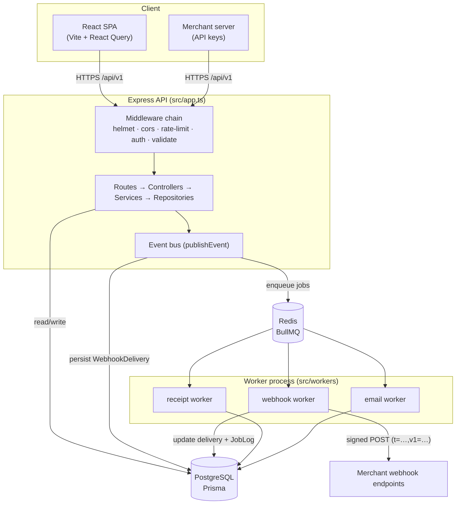

# StripeForge

> An educational, Stripe-inspired payment platform — double-entry ledger, payment-intent
> state machine, background workers, and signed webhooks — built to teach how a real
> payments backend fits together.

[](./LICENSE)
[](https://www.typescriptlang.org/)
[](https://nodejs.org/)
[](https://expressjs.com/)
[](https://www.prisma.io/)
[](https://www.postgresql.org/)
[](https://redis.io/)
[](https://docs.bullmq.io/)
[](https://react.dev/)
[](https://vitejs.dev/)
[](https://vitest.dev/)
[](./.github/workflows/ci.yml)

---

## Table of Contents

- [Project Overview](#project-overview)
- [Screenshots](#screenshots)
- [Features](#features)
- [Architecture](#architecture)
- [Tech Stack](#tech-stack)
- [Monorepo Folder Structure](#monorepo-folder-structure)
- [API Overview](#api-overview)
- [Running Locally](#running-locally)
- [Environment Variables](#environment-variables)
- [Docker Setup](#docker-setup)
- [Testing](#testing)
- [Documentation](#documentation)
- [Roadmap](#roadmap)
- [Learning Outcomes](#learning-outcomes)
- [License](#license)

---

## Project Overview

**StripeForge** is a from-scratch reimplementation of the *concepts* behind a modern
payment processor, built for learning. It is **not** PCI-compliant and must never touch
real card data — see [`docs/security.md`](./docs/security.md#pci-note). What it *does*
teach is the hard, interesting parts that a payments backend actually has to get right:

- A **double-entry ledger** where every movement of money posts balanced DEBIT/CREDIT
  legs, so the books always reconcile and balances are *derived*, never cached.
- A **PaymentIntent state machine** mirroring Stripe's lifecycle
  (`requires_payment_method → requires_confirmation → processing → succeeded/failed`,
  plus `canceled`).
- **Idempotency keys** so client retries can never double-charge.
- **Background processing** with BullMQ (webhook delivery, receipts, email) including
  retries with backoff and a dead-letter path.
- **Signed webhooks** with a Stripe-style HMAC signature (`t=…,v1=…`) and delivery logs.
- **Multi-tenant isolation** — every record is scoped to a `Merchant`.
- A clean **Repository → Service → Controller → Route** layering in strict TypeScript.

A React + Vite dashboard consumes the API to visualise payments, refunds, the ledger,
webhook deliveries, and background jobs.

## Screenshots

> Screenshots are placeholders. Drop real images into [`docs/images/`](./docs/images)
> (the folder is tracked via `.gitkeep`) and they will render here.

| Dashboard overview | Payment lifecycle | Ledger |
| --- | --- | --- |
|  |  |  |

## Features

### Auth & tenancy
- Merchant registration/login with **bcrypt** password hashing.
- **JWT access tokens** (short-lived) + **rotating opaque refresh tokens** (hash-stored, revocable).
- **API key pairs** (`pk_test_… / sk_test_…`) for server-to-server calls.
- **Role-based access** (`OWNER` / `ADMIN` / `VIEWER`).

### Payments
- **Customers** scoped per merchant (unique email per tenant).
- **PaymentIntents** with a full lifecycle state machine and `clientSecret`.
- **Payments** capture with idempotency guarantees.
- **Refunds** (full & partial) with `amountRefunded` limit enforcement.

### Ledger & money
- **Append-only double-entry ledger** (`MERCHANT_BALANCE`, `PLATFORM_FEES`, `CASH`, `REFUNDS_PAYABLE`).
- Balanced transactions (debits == credits) grouped by `transactionId`.
- **Derived merchant balances** — never a mutable balance column.
- Money stored as **`BigInt` minor units** end to end.

### Events, queues & webhooks
- Domain **event bus** (`payment.succeeded/failed/processing`, `refund.created`).
- **BullMQ queues** (`webhook`, `receipt`, `email`) with workers, retries + backoff, and a **dead-letter** state.
- **Signed webhook delivery** with retries, delivery logs, and a `dead` terminal state.
- **JobLog** mirror of queue state for dashboard observability.

### Observability & safety
- Central error handler with a consistent error envelope.
- **AuditLog** of security/money-relevant actions.
- Rate limiting, Helmet, CORS, Zod input validation.

### Frontend
- React 18 + Vite + TypeScript + Tailwind.
- **React Query** data fetching with an **auth token-refresh interceptor**.
- Recharts dashboards.

## Architecture

StripeForge is a TypeScript monorepo: an Express API, a separate BullMQ worker process,
Postgres (via Prisma), Redis (BullMQ backing store), and a React SPA. The API enqueues
jobs; the worker consumes them and delivers webhooks.



See [`docs/architecture.md`](./docs/architecture.md) for the layered architecture, the
request lifecycle, and the module map. All diagrams are collected in
[`docs/mermaid.md`](./docs/mermaid.md).

## Tech Stack

| Layer | Technology | Why |
| --- | --- | --- |
| Language | **TypeScript** (strict) | Type safety across money/state-machine logic |
| API framework | **Express 4** | Minimal, ubiquitous, easy to teach ([ADR-001](./docs/adr/001-express.md)) |
| ORM | **Prisma 6** | Type-safe queries + migrations ([ADR-002](./docs/adr/002-prisma.md)) |
| Database | **PostgreSQL 16** | Transactions, `String[]`, JSON, integrity ([ADR-003](./docs/adr/003-postgres.md)) |
| Queue | **BullMQ 5** | Robust Redis-backed jobs, retries, DLQ ([ADR-004](./docs/adr/004-bullmq.md)) |
| Cache/broker | **Redis 7** | BullMQ backing store ([ADR-005](./docs/adr/005-redis.md)) |
| Auth | **jsonwebtoken** + **bcryptjs** | Access JWTs + hashed passwords/refresh tokens |
| Validation | **Zod** | Runtime request validation |
| Logging | **pino** / **pino-http** | Fast structured logs |
| Security | **helmet**, **cors**, **express-rate-limit** | Hardened HTTP surface |
| Frontend | **React 18** + **Vite 5** | Fast SPA tooling |
| Data fetching | **@tanstack/react-query** | Caching/retries ([ADR-006](./docs/adr/006-react-query.md)) |
| Styling | **Tailwind CSS** | Utility-first UI ([ADR-007](./docs/adr/007-tailwind.md)) |
| Charts | **Recharts** | Dashboard visualisations |
| Testing | **Vitest** + **supertest** | Unit + HTTP integration |
| Containers | **Docker Compose** | One-command local stack |

## Monorepo Folder Structure

```text
stripe-forge/
├── backend/                  # Express API + BullMQ worker (TypeScript)
│   ├── prisma/               # Prisma schema, migrations, seed
│   ├── src/
│   │   ├── config/           # env, logger, prisma, redis (shared singletons)
│   │   ├── utils/            # AppError, http helpers, serialize, jwt, crypto, password, audit
│   │   ├── middlewares/      # auth, validate, errorHandler
│   │   ├── repositories/     # Prisma-only data access (per model)
│   │   ├── services/         # business logic, transactions, invariants
│   │   ├── controllers/      # thin request handlers (parse → service → respond)
│   │   ├── validators/       # Zod schemas per module
│   │   ├── routes/           # express Routers; index.ts mounts everything under /api/v1
│   │   ├── events/           # domain event bus + fan-out to webhook queue
│   │   ├── queues/           # BullMQ queue definitions + producers
│   │   ├── workers/          # BullMQ worker process (webhook/receipt/email)
│   │   ├── webhooks/         # HMAC signature signing/verification
│   │   ├── types/            # shared TS types + express augmentation
│   │   ├── app.ts            # Express app factory (createApp)
│   │   └── server.ts         # HTTP bootstrap + graceful shutdown
│   └── tests/                # vitest unit + (skipped) integration tests
├── frontend/                 # React 18 + Vite + Tailwind SPA
│   └── src/                  # components, pages, hooks, api client, router
├── docs/                     # architecture, module, and reference docs (+ ADRs)
│   ├── adr/                  # Architecture Decision Records
│   └── images/               # screenshots (place PNGs here)
├── docker-compose.yml        # postgres · redis · api · worker · frontend
├── .github/workflows/ci.yml  # typecheck · lint · test · build
├── LICENSE                   # MIT
└── README.md                 # you are here
```

Full annotated tree: [`docs/folder-structure.md`](./docs/folder-structure.md).

## API Overview

All endpoints are mounted under **`/api/v1`** and (except auth register/login) require a
`Authorization: Bearer <accessToken>` header. Responses use the envelope
`{ success: true, data, meta? }` / `{ success: false, error: { code, message } }`.

| Module | Method & Path | Purpose |
| --- | --- | --- |
| Auth | `POST /auth/register` | Create a merchant + API keys |
| Auth | `POST /auth/login` | Get access + refresh tokens |
| Auth | `POST /auth/refresh` | Rotate refresh → new access token |
| Auth | `POST /auth/logout` | Revoke a refresh token |
| Customers | `GET/POST /customers`, `GET/PATCH/DELETE /customers/:id` | Manage customers |
| Payment Intents | `POST /payment_intents` | Create an intent (`requires_payment_method`) |
| Payment Intents | `POST /payment_intents/:id/confirm` | Advance the state machine |
| Payment Intents | `POST /payment_intents/:id/cancel` | Cancel an intent |
| Payments | `GET /payments`, `GET /payments/:id` | List/inspect captured payments |
| Refunds | `POST /refunds` | Refund a payment (full/partial) |
| Ledger | `GET /ledger` | List ledger entries |
| Ledger | `GET /ledger/balance` | Derived merchant balance |
| Webhook endpoints | `GET/POST /webhook_endpoints`, `.../:id` | Register/manage endpoints |
| Webhook deliveries | `GET /webhook_deliveries` | Delivery logs + status |
| Jobs | `GET /jobs` | Background job observability |
| Dashboard | `GET /dashboard` | Aggregated metrics |

Full request/response reference (with examples & error cases):
[`docs/api.md`](./docs/api.md).

## Running Locally

### Prerequisites

- **Node.js 20+** and **npm**
- **Docker** + **Docker Compose** (for the easy path), or a local **PostgreSQL 16** and **Redis 7**

### Option A — Docker (everything, one command)

```bash
git clone <your-fork-url> stripe-forge
cd stripe-forge
docker compose up --build
```

This starts Postgres, Redis, the API (which runs `prisma migrate deploy` on boot), the
worker, and the frontend. Then open:

- Frontend: <http://localhost:5173>
- API health: <http://localhost:4000/health>

### Option B — Manual (run each piece yourself)

1. **Start infrastructure only:**

   ```bash
   docker compose up -d postgres redis
   ```

2. **Backend setup:**

   ```bash
   cd backend
   cp .env.example .env          # then edit secrets as needed
   npm install
   npm run prisma:generate
   npm run prisma:migrate        # creates tables in your dev DB
   npm run seed                  # (optional) demo merchant + data
   ```

3. **Run the API and the worker** (two terminals):

   ```bash
   npm run dev        # API on :4000
   npm run worker     # BullMQ worker (webhook/receipt/email)
   ```

4. **Frontend:**

   ```bash
   cd ../frontend
   cp .env.example .env          # set VITE_API_BASE_URL if needed
   npm install
   npm run dev                   # SPA on :5173 (proxies /api → :4000)
   ```

> The API and the worker are **separate processes** on purpose — see
> [`docs/queues.md`](./docs/queues.md) and [`docs/deployment.md`](./docs/deployment.md)
> for how they scale independently.

## Environment Variables

Backend config is validated at boot by `src/config/env.ts` (the app **fails fast** on a
bad config). Copy `backend/.env.example` → `backend/.env`.

| Variable | Required | Default | Description |
| --- | --- | --- | --- |
| `NODE_ENV` | no | `development` | `development` \| `test` \| `production` |
| `PORT` | no | `4000` | API port |
| `LOG_LEVEL` | no | `info` | pino log level |
| `CORS_ORIGINS` | no | `http://localhost:5173` | Comma-separated allowed origins |
| `DATABASE_URL` | **yes** | — | Postgres connection string |
| `REDIS_HOST` | no | `localhost` | Redis host (BullMQ) |
| `REDIS_PORT` | no | `6379` | Redis port |
| `JWT_ACCESS_SECRET` | **yes** | — | Secret for access tokens (min 8 chars) |
| `JWT_REFRESH_SECRET` | **yes** | — | Secret for refresh flow (min 8 chars) |
| `JWT_ACCESS_TTL` | no | `900` | Access token TTL (seconds) |
| `JWT_REFRESH_TTL` | no | `604800` | Refresh token TTL (seconds) |
| `RATE_LIMIT_WINDOW_MS` | no | `60000` | Rate-limit window |
| `RATE_LIMIT_MAX` | no | `100` | Max requests per window |
| `WEBHOOK_MAX_ATTEMPTS` | no | `5` | Max webhook delivery attempts before `dead` |

Frontend: `VITE_API_BASE_URL` (e.g. `http://localhost:4000/api/v1`).

## Docker Setup

`docker-compose.yml` defines five services:

| Service | Image / Build | Ports | Notes |
| --- | --- | --- | --- |
| `postgres` | `postgres:16-alpine` | `5432` | Volume-backed, healthcheck |
| `redis` | `redis:7-alpine` | `6379` | Healthcheck |
| `api` | `./backend` (Dockerfile) | `4000` | Runs `prisma migrate deploy` then `node dist/server.js` |
| `worker` | `./backend` (Dockerfile) | — | Runs `node dist/workers/index.js` |
| `frontend` | `./frontend` (Dockerfile) | `5173→80` | Nginx-served static build |

The API and worker share the same image but run different commands. Full prod guidance
(scaling workers, health checks, graceful shutdown, migrate-on-deploy) is in
[`docs/deployment.md`](./docs/deployment.md).

## Testing

```bash
cd backend
npm test                       # unit tests (fast, no infra)
npm run test:watch             # watch mode
npx vitest run tests/unit      # unit only
npx vitest run tests/integration   # integration (skipped by default; needs Postgres+Redis)
```

Unit tests cover the pure, high-leverage logic: money serialization, pagination bounds,
JWT round-trip, webhook signature verification, and the double-entry ledger invariant.
Integration tests exercise the real app over HTTP and are **skipped by default** so the
default run needs no infrastructure. Details and *why each test exists*:
[`docs/testing.md`](./docs/testing.md) and `backend/tests/README.md`.

## Documentation

| Doc | What's inside |
| --- | --- |
| [architecture.md](./docs/architecture.md) | Layers, request lifecycle, module map |
| [backend.md](./docs/backend.md) | Folder layout, conventions, error handling, adding a module |
| [frontend.md](./docs/frontend.md) | React structure, React Query, token refresh, routing |
| [payment-lifecycle.md](./docs/payment-lifecycle.md) | State machine, idempotency, ledger/events/webhooks per step |
| [database.md](./docs/database.md) | Every table: columns, relations, indexes, why it exists (+ ER diagram) |
| [queues.md](./docs/queues.md) | BullMQ design, workers, retries/backoff, DLQ, JobLog |
| [webhooks.md](./docs/webhooks.md) | Registration, events, HMAC scheme, retries, delivery logs |
| [security.md](./docs/security.md) | JWT, bcrypt, API keys, rate limiting, tenancy, audit, PCI note |
| [deployment.md](./docs/deployment.md) | Docker images, prod env, scaling, health, graceful shutdown |
| [testing.md](./docs/testing.md) | Strategy, tools, coverage, why the key tests exist |
| [folder-structure.md](./docs/folder-structure.md) | Annotated monorepo tree |
| [api.md](./docs/api.md) | Full API reference with examples |
| [mermaid.md](./docs/mermaid.md) | All diagrams in one place |
| [future-roadmap.md](./docs/future-roadmap.md) | Planned features + how Stripe does them |
| [adr/000-index.md](./docs/adr/000-index.md) | Architecture Decision Records |

## Roadmap

Documented placeholders for Subscriptions, Invoicing, Multi-Currency, Connect Accounts,
Fraud Detection, Usage Billing, PCI Compliance, Event Sourcing, Distributed Workers,
Multi-Region, GraphQL API, and a Mobile SDK — each with *what it is*, *how Stripe does
it*, and *how you'd add it here*: [`docs/future-roadmap.md`](./docs/future-roadmap.md).

## Learning Outcomes

Building/reading StripeForge teaches you to:

- Model money correctly with **integer minor units** and a **double-entry ledger**, and
  derive balances instead of caching them.
- Implement a **state machine** for payments and reason about valid transitions.
- Guarantee **idempotency** so retries never double-charge.
- Design **background processing** with retries, backoff, and dead-letter handling.
- Build **secure webhooks** with HMAC signatures and replay protection.
- Apply clean **layered architecture** (repository/service/controller/route) in strict TS.
- Enforce **multi-tenant isolation** and keep an **audit trail**.
- Wire a **React Query** frontend with transparent **token refresh**.
- Ship with **Docker Compose** and a **CI** pipeline.

## License

[MIT](./LICENSE) © 2026 Sourav Kashyap.
