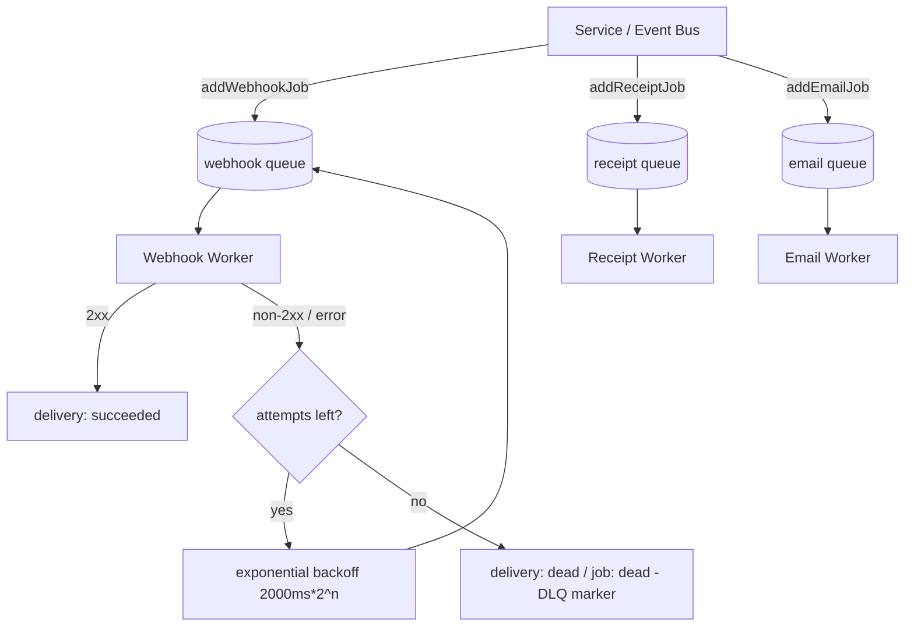

# Queues Module

## Purpose
Producer side of StripeForge's async platform. Defines the BullMQ queues used to
offload side effects (webhook delivery, receipt generation, transactional email)
from the request/response path, plus the retry and dead-letter policy.

## Responsibilities
- Own the canonical queue names (`queue.names.ts`).
- Construct one `Queue` instance per queue over the shared Redis connection.
- Expose typed `add*Job` producers with sensible default job options.
- Provide `getQueues()` / `closeQueues()` for graceful shutdown.

## Flow


## Public APIs
- `QUEUE_NAMES` — `{ WEBHOOK:'webhook', RECEIPT:'receipt', EMAIL:'email' }`.
- `addWebhookJob(data: WebhookJobData)` → enqueues on `webhook` (`{ deliveryId }`).
- `addReceiptJob(data: ReceiptJobData)` → enqueues on `receipt`.
- `addEmailJob(data: EmailJobData)` → enqueues on `email`.
- `getQueues(): Queue[]`, `closeQueues(): Promise<void>`.
- Job payload types live in `src/types/jobs.ts`.

## Business Rules
- Webhook attempts = `env.WEBHOOK_MAX_ATTEMPTS` (default 5); receipt/email = 3.
- Backoff: exponential, base delay 2000ms.
- Retention: `removeOnComplete: 1000`, `removeOnFail: 5000`. Failed jobs are kept
  so exhausted ("dead") jobs stay inspectable — the retained failed set doubles
  as the dead-letter record (see DLQ below).

## Dependencies
- `bullmq`, `../config/redis` (`redisConnection`), `../config/env`, `../types/jobs`.

## Example Request (producer usage)
```ts
import { addWebhookJob } from '../queues';
await addWebhookJob({ deliveryId: 'a1b2...' });
```

## Example Response
`add*Job` resolves to the BullMQ `Job` instance (has `.id`, `.name`, etc.).

## Dead Letter Queue (design choice)
We model the DLQ as a **status**, not a separate BullMQ queue. When a job exhausts
its attempts, the worker's `failed` handler sets the domain row to `dead`
(`WebhookDelivery.status='dead'`) and writes a `JobLog` with `status='dead'`.
Because `removeOnFail` retains failed jobs, the underlying BullMQ job also remains
for inspection. This keeps the model simple while giving the dashboard a queryable
DLQ view. A merchant can re-drive a dead delivery via
`POST /api/v1/webhook_deliveries/:id/retry`.

## Future Improvements
- Per-event-type priority queues; rate-limiting per merchant endpoint.
- Move dead jobs to a dedicated `dead-letter` queue for isolated replay tooling.
- Idempotency keys on jobs to dedupe double-enqueues.

## How Stripe Solves This
Stripe delivers webhooks asynchronously with automatic retries over an increasing
backoff window (up to ~3 days), disables endpoints that fail persistently, and
exposes an event log + manual "resend" in the dashboard. Our status-based DLQ +
retry endpoint is a scaled-down version of that model.
