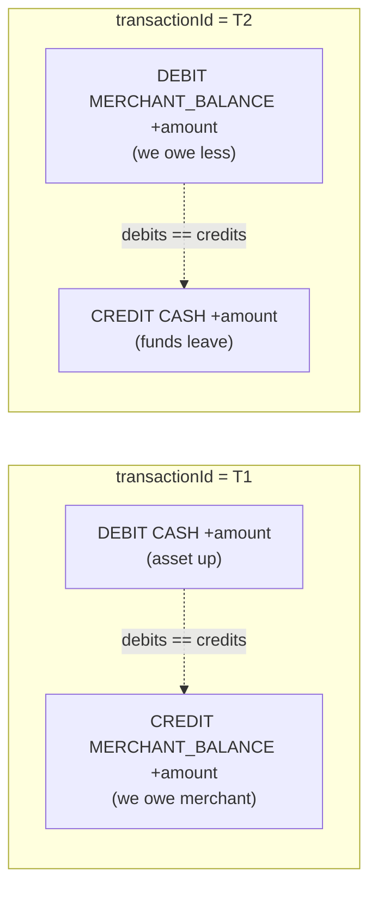

# Ledger Module (Double-Entry)

## Purpose
The ledger is the accounting source of truth. It is **append-only** and
**double-entry**: every movement of money is recorded as two or more balanced
`DEBIT`/`CREDIT` legs that sum to zero. Balances are always *derived* from these
immutable entries — never stored — so the books can never silently drift.

## Responsibilities
- Post balanced transactions for payments (`recordPaymentSucceeded`) and refunds
  (`recordRefund`), always inside the caller's DB transaction.
- Derive a merchant's available balance from the entries.
- Serve a paginated ledger history (filterable by account / transactionId).

## The Double-Entry Invariant
For any single `transactionId`, the sum of DEBITs equals the sum of CREDITs.
This is what makes the ledger self-auditing: a missing or wrong leg breaks the
zero-sum and reconciliation catches it. Rows are never updated or deleted;
corrections are new compensating transactions.

### Sign convention (simplified for teaching)
- `MERCHANT_BALANCE` is a **liability** we owe the merchant → CREDIT increases it,
  DEBIT decreases it.
- `CASH` is a platform **asset** representing funds actually held.

## Double-Entry Flow


Available balance = `SUM(CREDIT) - SUM(DEBIT)` over `MERCHANT_BALANCE`.

## Public APIs
| Method | Path                        | Description                        |
|--------|-----------------------------|------------------------------------|
| GET    | `/api/v1/ledger`              | Paginated history (account/txn filters) |
| GET    | `/api/v1/ledger/balance`      | Available merchant balance         |

Internal (called by other services, not HTTP):
- `recordPaymentSucceeded(tx, { merchantId, paymentId, amount, currency })`
- `recordRefund(tx, { merchantId, paymentId, refundId, amount, currency })`
- `getMerchantBalance(merchantId, currency?)`

## Business Rules
- Entries are immutable — no update/delete paths exist.
- Every posting is atomic with the payment/refund that caused it (shared `tx`).
- All reads scope by `merchantId`.
- Balances are computed, never cached in a column.

## Dependencies
- `repositories/ledger.repository.ts`
- `utils/crypto` (`generateToken` for `transactionId`)

## Example Request
```http
GET /api/v1/ledger/balance?currency=usd
Authorization: Bearer <token>
```

## Example Response
```json
{ "success": true, "data": { "available": 4200, "currency": "usd" } }
```

Ledger history entry:
```json
{
  "id": "le_...",
  "transactionId": "a1b2...",
  "account": "MERCHANT_BALANCE",
  "direction": "CREDIT",
  "amount": 4200,
  "currency": "usd",
  "paymentId": "pay_..."
}
```

## Future Improvements
- `PLATFORM_FEES` legs (split the merchant credit into fee + net).
- `REFUNDS_PAYABLE` staging account for asynchronous refund settlement.
- Periodic reconciliation job asserting `SUM(DEBIT) == SUM(CREDIT)` globally.
- Materialized balance snapshots for O(1) reads at scale.

## How Stripe Solves This
Stripe runs an internal double-entry ledger at massive scale; the public
`Balance` and `BalanceTransaction` objects are the merchant-facing projection of
it. Every charge, refund, fee, and payout is a balance transaction, and payouts
move funds from the Stripe balance to the merchant's bank. StripeForge models the
same invariant (debits == credits, derived balances) with a deliberately small
chart of accounts.
