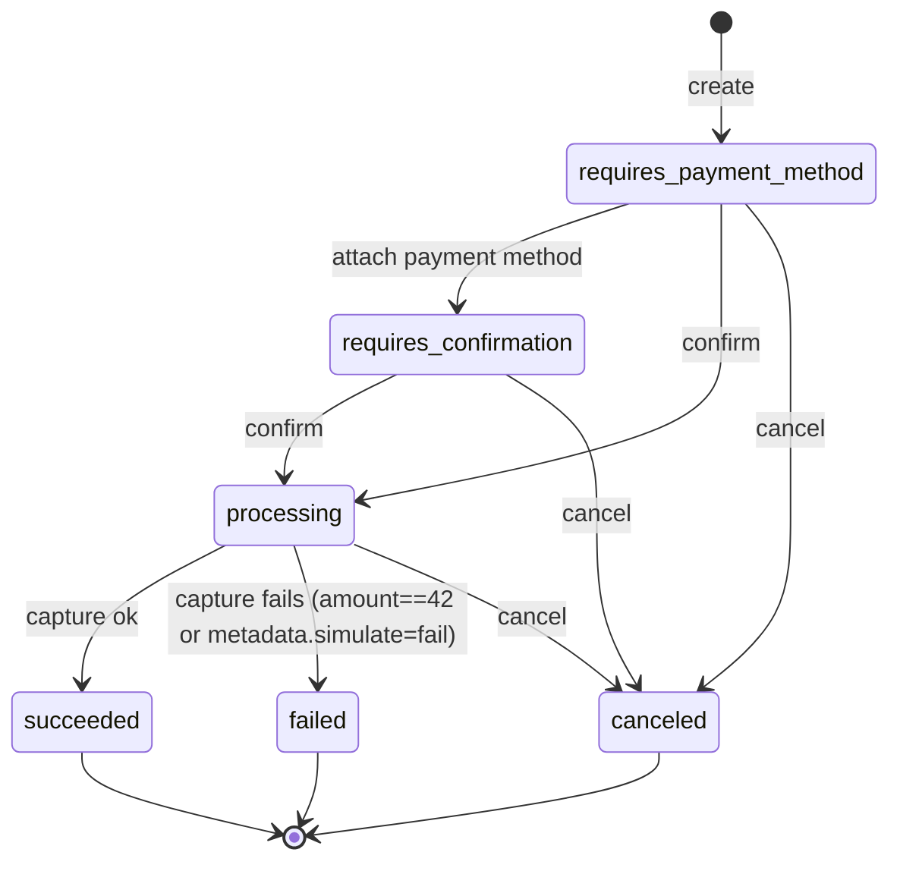

# Payment Intents Module

## Purpose
The Payment Intent is the core state machine that models the lifecycle of a single
charge attempt — from creation, through confirmation and processing, to a terminal
`succeeded` / `failed` / `canceled` state. It is the orchestrator that produces
`Payment` rows and double-entry `LedgerEntry` records.

## Responsibilities
- Create intents (with idempotency), retrieve, list.
- Drive lifecycle transitions and enforce which transitions are legal.
- On confirm: simulate processing, create the `Payment`, post balanced ledger
  legs, and publish domain events / enqueue receipts.

## State Machine


## Flow (confirm)
```
POST /:id/confirm
  └─ service.confirmPaymentIntent
       ├─ guard: status ∈ {requires_payment_method, requires_confirmation}
       ├─ set status = processing; emit 'payment.processing'
       ├─ decide success/fail (test rule: amount==42 or metadata.simulate=='fail')
       └─ prisma.$transaction:
            ├─ create Payment (succeeded|failed)
            ├─ [success] ledgerService.recordPaymentSucceeded(tx, …)
            └─ set intent status = succeeded|failed
       └─ after commit: emit 'payment.succeeded'|'payment.failed' + enqueue receipt
```

## Public APIs
| Method | Path                                | Description            |
|--------|-------------------------------------|------------------------|
| POST   | `/api/v1/payment_intents`             | Create (idempotent)  |
| GET    | `/api/v1/payment_intents`             | List (status filter) |
| GET    | `/api/v1/payment_intents/:id`         | Retrieve             |
| POST   | `/api/v1/payment_intents/:id/confirm` | Confirm & process    |
| POST   | `/api/v1/payment_intents/:id/cancel`  | Cancel               |

## Business Rules
- **Idempotency**: an `Idempotency-Key` header (stored on the intent) makes a retry
  return the original intent instead of creating a duplicate charge. A race on the
  unique index is caught and resolved to the existing record.
- `amount` must be a positive integer in minor units; stored as `BigInt`.
- A referenced `customerId` must belong to the merchant.
- Confirm is only legal from `requires_payment_method` / `requires_confirmation`.
- Cancel is only legal from a non-terminal state.
- Money-moving work runs inside one DB transaction; events fire **after** commit so
  a rolled-back transaction never emits a webhook.
- **Test/simulation rule**: `amount === 42` or `metadata.simulate === 'fail'`
  forces the failure path; everything else succeeds.

## Dependencies
- `repositories/paymentIntent.repository.ts`, `payment.repository.ts`, `customer.repository.ts`
- `services/ledger.service.ts` (double-entry posting)
- `events/emit.ts` (domain events → eventBus, Agent C)
- `events/enqueue.ts` (receipt queue, Agent C)

## Example Request
```http
POST /api/v1/payment_intents
Authorization: Bearer <token>
Idempotency-Key: 9f1c-abc

{ "amount": 4200, "currency": "usd", "customerId": "b1f2..." }
```

## Example Response
```json
{
  "success": true,
  "data": {
    "id": "pi_...",
    "amount": 4200,
    "currency": "usd",
    "status": "requires_payment_method",
    "clientSecret": "pi_secret_ab12...",
    "idempotencyKey": "9f1c-abc"
  }
}
```

## Future Improvements
- Real payment-method attachment step (card tokens, 3-D Secure).
- Automatic vs manual capture modes.
- Partial captures and authorization holds.

## How Stripe Solves This
Stripe's PaymentIntent encapsulates the entire charge lifecycle including SCA/3DS
challenges (`requires_action`) and automatic retries. The `client_secret` is used
by Stripe.js on the frontend to confirm the payment without exposing secret keys.
Idempotency keys are a first-class HTTP header across the whole API, guaranteeing
that network retries never double-charge — StripeForge mirrors this exactly at the
PaymentIntent creation boundary.
