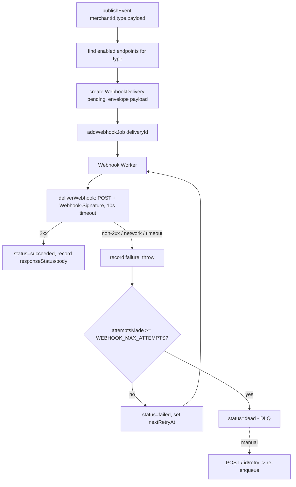

# Webhooks Module

## Purpose
Endpoint management and delivery mechanics for outbound webhooks. Merchants
register HTTPS endpoints; domain events fan out to matching endpoints as signed,
retried HTTP POSTs.

## Responsibilities
- `signature.ts` — HMAC-SHA256 signing/verification (Stripe-style header).
- `../repositories/webhook.repository.ts` — endpoint + delivery persistence
  (endpoints scoped by `merchantId`; deliveries scoped via their endpoint).
- `../services/webhook.service.ts` — endpoint CRUD + `deliverWebhook(deliveryId)`.
- `../controllers/webhook.controller.ts` + routes — HTTP surface.
- Event fan-out lives in `../events/eventBus.ts`.

## Flow


## Public APIs
Endpoint management (`/api/v1/webhook_endpoints`, all `requireAuth`):
- `POST /` create `{ url, enabledEvents[] }` → returns endpoint incl. `signingSecret`.
- `GET /` list (paginated), `GET /:id`, `PATCH /:id`, `DELETE /:id`.

Deliveries (`/api/v1/webhook_deliveries`, all `requireAuth`):
- `GET /` list (paginated, optional `?endpointId=`), `GET /:id`,
  `POST /:id/retry` (re-enqueue a failed/dead delivery).

Service: `registerEndpoint`, `list/get/update/deleteEndpoint`,
`listDeliveries`, `getDelivery`, `deliverWebhook(deliveryId)`.

## Signature Scheme
- Signed content: `` `${timestamp}.${payload}` `` where `timestamp` is unix seconds
  and `payload` is the raw JSON body sent.
- Algorithm: HMAC-SHA256 with the endpoint's `signingSecret` (`whsec_...`).
- Header sent as `Webhook-Signature: t=<ts>,v1=<hexsig>`.
- Verification (`verifySignature`): recompute over `${t}.${payload}`, constant-time
  compare (`timingSafeEqual`), and reject if `|now - t| > toleranceSec` (default
  300s) to defeat replay attacks.

## Business Rules
- Endpoints/deliveries are strictly merchant-scoped (deliveries via their endpoint).
- An endpoint with empty `enabledEvents` receives **all** supported event types.
- Only enabled endpoints receive deliveries.
- A 2xx response = success; anything else (or a network/timeout error) fails and
  is retried until `WEBHOOK_MAX_ATTEMPTS`, then dead-lettered.
- `responseStatus`/`responseBody` (capped at 2000 chars) are recorded per attempt.

## Dependencies
- `node:crypto`, global `fetch` (Node 22, no node-fetch), `AbortController`.
- `../repositories/webhook.repository`, `../utils/crypto`, `../utils/AppError`.

## Example Request
```
POST /api/v1/webhook_endpoints
Authorization: Bearer <access>
{ "url": "https://merchant.example.com/hooks", "enabledEvents": ["payment.succeeded"] }
```

## Example Response
```json
{
  "success": true,
  "data": {
    "id": "…",
    "url": "https://merchant.example.com/hooks",
    "signingSecret": "whsec_…",
    "enabledEvents": ["payment.succeeded"],
    "enabled": true
  }
}
```

## Future Improvements
- Endpoint auto-disable after sustained failures; per-endpoint secrets rotation.
- Signed payload versioning (`v1`, `v2`) and multiple active secrets.
- Delivery de-duplication and ordered per-endpoint delivery.

## How Stripe Solves This
Stripe signs each event with `Stripe-Signature: t=..,v1=..` over `${t}.${body}`
using a per-endpoint secret, retries with backoff, and lets merchants inspect and
resend events. This module mirrors that scheme closely.
