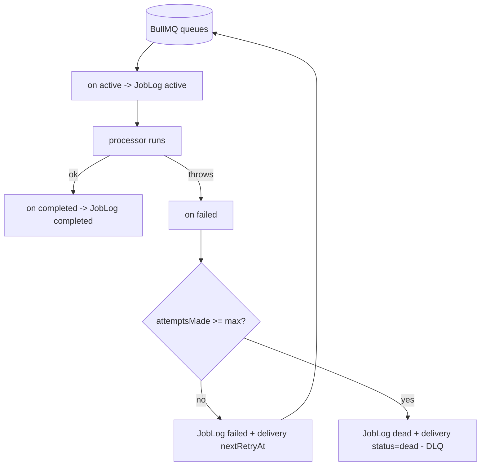

# Workers Module

## Purpose
Consumer side of the async platform. A single worker process (`npm run worker`)
runs three BullMQ workers that drain the `webhook`, `receipt`, and `email` queues,
persisting job state to `JobLog` for dashboard visibility.

## Responsibilities
- `webhook.worker.ts` — deliver webhooks via `webhookService.deliverWebhook`;
  implement retry + dead-letter transitions.
- `receipt.worker.ts` — simulate receipt generation/send.
- `email.worker.ts` — simulate transactional email send.
- `index.ts` — start all workers, log readiness, graceful shutdown.

## Flow


## Public APIs
- `createWebhookWorker()`, `createReceiptWorker()`, `createEmailWorker()` — each
  returns a configured BullMQ `Worker`. `index.ts` wires them and shutdown.

## Business Rules
- Every transition (`active`/`completed`/`failed`/`dead`) is written to `JobLog`
  via `jobLogRepository.upsertJobLog` keyed logically by `(queue, jobId)`.
- Webhook max attempts = `env.WEBHOOK_MAX_ATTEMPTS`; receipt/email = job `attempts`
  (default 3). On exhaustion the webhook worker marks the `WebhookDelivery` `dead`.
- On a non-final failure the webhook worker stamps `nextRetryAt` (exponential,
  base 2000ms) so the dashboard can show when the next attempt is due.

## Dead Letter Queue
No separate BullMQ queue. "Dead" is a terminal **status** on both `WebhookDelivery`
and `JobLog` after attempts are exhausted; `removeOnFail: 5000` retains the failed
BullMQ jobs for inspection. Re-drive a dead webhook delivery via
`POST /api/v1/webhook_deliveries/:id/retry`.

## Dependencies
- `bullmq`, `../config/redis`, `../config/env`, `../config/logger`,
  `../config/prisma`, `../queues`, `../services/webhook.service`,
  `../repositories/{webhook,jobLog}.repository`, `../types/jobs`.

## How to Run
```
npm run worker        # dev (tsx)
npm run worker:prod   # compiled (node dist/workers/index.js)
```
Requires Redis reachable at `REDIS_HOST:REDIS_PORT` and a valid `DATABASE_URL`.

## Example (observed log on startup)
```
{"level":"info","queues":["webhook","receipt","email"],"msg":"workers ready"}
```

## Example (webhook delivered)
```
{"level":"info","deliveryId":"…","status":200,"msg":"webhook delivered"}
```

## Future Improvements
- Concurrency + rate-limit tuning per queue; separate worker processes per queue.
- Metrics export (Prometheus) and structured DLQ replay tooling.
- Backoff jitter to avoid thundering-herd retries.

## How Stripe Solves This
Stripe runs large fleets of workers off durable queues with automatic retries,
backoff, and endpoint health tracking. Job/event state is observable in the
dashboard. This module is a compact, single-process illustration of that pattern.
