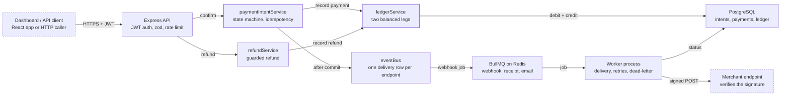

# StripeForge: design notes

A payments API that models the hard parts: an intent state machine, idempotency, a ledger that must balance, and webhook delivery with retries.

## In short

I built StripeForge to learn how a payments system stays correct. Creating a payment is idempotent through a unique key. Confirming one is a single conditional update, so two requests cannot both win. Success writes a payment, two balanced ledger legs and the new status in one transaction. After commit, an event is fanned out to merchant endpoints through a BullMQ queue and delivered as an HMAC-signed POST with exponential retries. There is no card processor: outcomes are simulated.

## Architecture

Money changes go through the ledger inside one database transaction. Events are published only after that transaction commits, then delivered by a separate worker process.

## How a payment is created and confirmed

1. `POST /api/v1/payment_intents` passes JWT auth and a role check. The controller validates the body with zod and reads the `Idempotency-Key` header.
2. `createPaymentIntent` looks for an existing intent with that key. If found and the amount and currency match, it returns it; a mismatch is a 409. Otherwise it inserts a new intent in `requires_payment_method`.
3. If two requests race, the unique index on `(merchantId, idempotencyKey)` rejects one, and that request re-reads the winner's row.
4. `POST /:id/confirm` calls `claimForConfirmation`: one conditional `updateMany` that moves the intent to `processing` only if it is still confirmable. Zero rows updated means someone else got there first.
5. The outcome is simulated: it fails if the metadata asks for it or the amount is 42, otherwise it succeeds.
6. On success, one `prisma.$transaction` creates the payment, writes the ledger legs (DEBIT cash, CREDIT merchant balance) and sets the intent to `succeeded`.
7. After commit, `publishEvent` builds an envelope, creates a `WebhookDelivery` row per matching endpoint and enqueues a job for each.
8. The worker re-checks the URL, signs the body, and POSTs with a 10 s timeout and no redirect following. A non-2xx throws so BullMQ retries with exponential backoff.
9. After five failed attempts the delivery is marked `dead`. It can be retried manually.

## Libraries

| Library                                 | Used for                                                              |
| --------------------------------------- | --------------------------------------------------------------------- |
| `express`                               | HTTP API with helmet, cors, compression and pino logging.             |
| `@prisma/client + PostgreSQL`           | 11 models. `BigInt` columns for money.                                |
| `bullmq + ioredis`                      | Three queues (webhook, receipt, email) and a separate worker process. |
| `zod`                                   | Request validation and environment validation.                        |
| `jsonwebtoken, bcryptjs`                | Short-lived access tokens and password hashing.                       |
| `express-rate-limit + rate-limit-redis` | 100 requests a minute globally, 10 per 15 minutes on auth routes.     |
| `React, Vite, TanStack Query`           | The dashboard.                                                        |

## Design decisions and trade-offs

### Double-entry ledger

Every money movement writes two legs of equal amount with a shared `transactionId`. The balance is `SUM(CREDIT) − SUM(DEBIT)`.

**Trade-off:** Balances are derived from immutable rows. The invariant holds only by how the code is written; there is no database constraint or reconciliation job.

### Idempotency through a unique index

A unique `(merchantId, idempotencyKey)` index, with the race handled and a parameter mismatch returning 409.

**Trade-off:** Covers intent creation only. Refunds have no idempotency key.

### State changes are one conditional update

`claimForConfirmation` and `tryIncrementAmountRefunded` are single `UPDATE … WHERE` statements evaluated under a row lock.

**Trade-off:** No read-then-write race. A `processing` intent can still be cancelled mid-confirm; that race is not guarded.

### Money as integers in minor units

`BigInt` in the database. The API accepts an integer and converts it.

**Trade-off:** No float drift. The JSON boundary uses JS numbers, so it is exact only below 2^53.

### Webhooks are signed and time-stamped

HMAC-SHA256 over `timestamp.body`, sent as `Webhook-Signature: t=…,v1=…`, verified with a 300 s tolerance and a constant-time compare.

**Trade-off:** Stops forgery and replay. Secrets are stored in plaintext and cannot be rotated.

### Outbound URLs are checked for SSRF

http/https only, a hostname blocklist, private IPv4 and IPv6 ranges, and a DNS lookup with every address checked, at registration and before each delivery.

**Trade-off:** A DNS-rebinding window remains, and IPv4-mapped IPv6 literals appear to slip past the check.

### At-least-once delivery

BullMQ retries up to five times with exponential backoff from 2 s. Receivers should dedupe on the event id.

**Trade-off:** No transactional outbox: a crash between commit and publish loses the event.

### Refresh tokens rotate, and reuse is punished

Refresh tokens are opaque, stored hashed and rotated on use. Reusing a revoked one revokes every token for that merchant.

**Trade-off:** Limits the damage from a stolen token. A legitimate client that retries can be logged out.

## Payment-intent states

- `requires_payment_method` or `requires_confirmation` → `processing` → `succeeded` or `failed`.
- Any non-terminal state → `canceled`.
- Each transition is guarded by a conditional update, so an intent cannot be confirmed twice.

## Why double-entry

- Every movement has a source and a destination. Debits must equal credits.
- An error shows up as an imbalance instead of silently wrong money.
- A payment: DEBIT cash, CREDIT merchant balance. A refund reverses both.

## Delivery guarantees

- Exactly-once delivery over a network is not achievable in general. Systems choose at-least-once and make the receiver idempotent.
- Here: at-least-once, with an event id the receiver can dedupe on.
- The missing piece is an outbox table written in the same transaction as the payment.

## Numbers

- **Models:** 11
- **Queues:** 3
- **Tests:** 30 unit tests; 1 integration file, skipped
- **Backend:** about 4,500 lines
- **Webhook retries:** 5 attempts, exponential from 2 s
- **Access token:** 15 minutes

## Design FAQ

### Why double-entry bookkeeping?

Every movement posts an equal debit and credit, so mistakes appear as an imbalance and balances come from immutable rows. Here the invariant holds by code shape and transaction atomicity only, with no database constraint or reconciliation. Fees and payouts are not modelled.

### How do you make payment creation idempotent?

An `Idempotency-Key` header and a unique `(merchantId, idempotencyKey)` index, with the race handled and a mismatch returning 409. Stripe stores the whole response per key for 24 hours across endpoints; this covers intent creation only.

### How do you stop a double confirm or an over-refund?

Each is a single conditional UPDATE that Postgres evaluates under a row lock, with a unique index as a backstop. Neither is a read followed by a write.

### How do you secure webhooks?

An HMAC over the timestamp and body with a per-endpoint secret, a tolerance window against replay, a constant-time compare, an SSRF check on the URL, and no redirect following.

### Why store money as integers?

Floats cannot represent decimal fractions exactly and drift when summed. The database uses `BigInt` minor units. The JSON boundary uses JS numbers, so it is safe only below 2^53.

### Is webhook delivery exactly-once?

No, it is at-least-once. BullMQ retries, and receivers should dedupe on the event id. Events are published after commit with no outbox, so a crash in between loses the event.

### How does multi-tenancy work?

Short-lived JWTs carry the merchant id and role. Every repository query filters by `merchantId`, and a viewer role cannot write on the main routes.

## Known limitations

- No real payments. There is no card data, no processor and no 3-D Secure; outcomes are synthetic.
- The README shows a CI badge, but the workflow file does not exist. Screenshots are placeholders.
- The ledger test checks a copy of the leg shapes, not the real `ledgerService`.
- The integration test is skipped, and it calls `/auth/register` while the route is `/auth/signup`.
- API keys are generated but nothing authenticates with them.
- No outbox, event ordering or ledger reconciliation.
- No tests for the payment-intent service, refunds, idempotency, the SSRF guard or the workers.
- Refunds are not idempotent.
- No capture/authorise split, disputes, payouts, fees or currency conversion.

---

Written from the source code as it stood on 26 November 2026.
