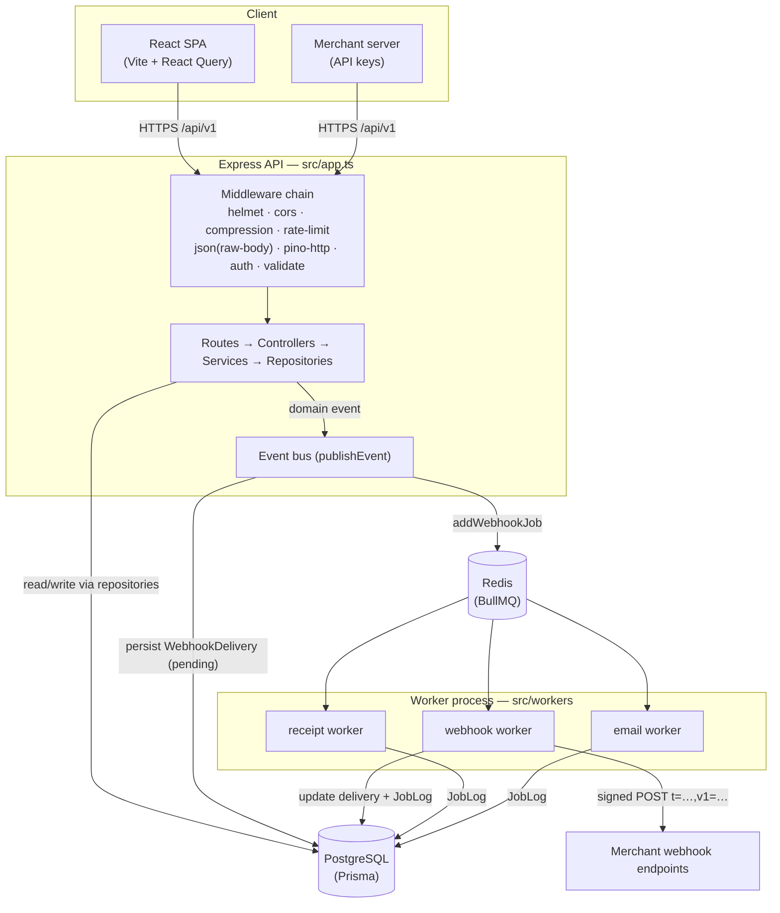
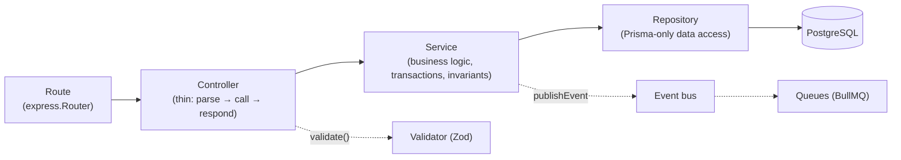
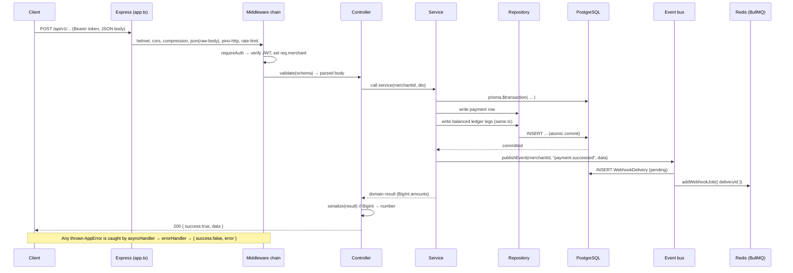

# Architecture

StripeForge is a TypeScript monorepo made of four runtime pieces — an **Express API**, a
**BullMQ worker process**, **PostgreSQL** (via Prisma), and **Redis** (BullMQ's backing
store) — plus a **React SPA**. This document explains how they fit together, the layered
design inside the backend, the lifecycle of a request, and where each module lives.

## System architecture

**Key idea:** the API never blocks a request on slow side effects (webhook delivery,
receipts, email). It commits the money change and its ledger legs in one DB transaction,
publishes a domain event, and returns. The event bus persists a `WebhookDelivery` and
enqueues a job; the **separate** worker process does the delivery with retries. This
keeps request latency low and side effects durable and observable.

## Layered architecture

The backend follows a strict one-directional dependency flow. Each layer has exactly one
job, which keeps business logic testable and swaps (e.g. changing the ORM) local.

| Layer | Location | Responsibility | Must NOT |
| --- | --- | --- | --- |
| **Route** | `src/routes/*.routes.ts` | Wire middleware + controller; export a `Router` | Contain logic |
| **Controller** | `src/controllers/*.controller.ts` | Parse/validate input, call a service, respond via `ok`/`paginated` + `serialize` | Talk to Prisma; hold business rules |
| **Service** | `src/services/*.service.ts` | Business logic, transactions, invariant checks, throw `AppError` subclasses, publish events | Touch `req`/`res` |
| **Repository** | `src/repositories/*.repository.ts` | Only Prisma calls; return Prisma models | Contain business rules |
| **Validator** | `src/validators/*.validator.ts` | Zod schemas + parse helper | — |

Cross-cutting helpers live in `src/utils` (`AppError`, `http`, `serialize`, `jwt`,
`crypto`, `password`, `audit`) and `src/config` (`env`, `logger`, `prisma`, `redis`).

## Request lifecycle

Every request flows through the same middleware chain and layer stack. Here is a
write request (e.g. capturing a payment) end to end:

Notes:
- `app.ts` stashes the **raw body** during JSON parsing so webhook signature checks can
  hash the exact received bytes.
- Controllers are wrapped in `asyncHandler` so a rejected promise reaches the **central
  error handler** (`src/middlewares/errorHandler.ts`), which maps `AppError` subclasses
  to the `{ success:false, error:{ code, message, details? } }` envelope.
- `serialize()` runs at the boundary because Prisma returns money as `BigInt`, which
  `JSON.stringify` cannot encode.

## Module map

| Module | Route prefix | Owner files (services/repos/controllers/validators/routes) |
| --- | --- | --- |
| Auth | `/api/v1/auth` | `auth.*` + `middlewares/auth.ts` |
| Customers | `/api/v1/customers` | `customer.*` |
| Payment Intents | `/api/v1/payment_intents` | `paymentIntent.*` |
| Payments | `/api/v1/payments` | `payment.*` |
| Refunds | `/api/v1/refunds` | `refund.*` |
| Ledger | `/api/v1/ledger` | `ledger.*` |
| Webhook endpoints | `/api/v1/webhook_endpoints` | `webhookEndpoint.*` |
| Webhook deliveries | `/api/v1/webhook_deliveries` | `webhookDelivery.*` |
| Jobs | `/api/v1/jobs` | `job.*` |
| Dashboard | `/api/v1/dashboard` | `dashboard.*` |

All routers are mounted by `src/routes/index.ts` under `/api/v1`.

## Cross-process communication

- **API → Worker:** never a direct call. The API enqueues jobs on Redis via BullMQ
  producers (`addWebhookJob`, `addReceiptJob`, `addEmailJob`). See
  [`queues.md`](./queues.md).
- **API → Merchant:** via signed webhooks delivered by the worker. See
  [`webhooks.md`](./webhooks.md).
- **Anything → DB:** only through repositories.

## Where to go next

- Backend conventions & how to add a module → [`backend.md`](./backend.md)
- Payment state machine → [`payment-lifecycle.md`](./payment-lifecycle.md)
- Data model → [`database.md`](./database.md)
- All diagrams in one place → [`mermaid.md`](./mermaid.md)
