# Backend Guide

The backend is an Express + TypeScript service using Prisma (Postgres) and BullMQ
(Redis). It is split into an **API process** (`src/server.ts` → `src/app.ts`) and a
**worker process** (`src/workers/index.ts`). This guide covers the folder layout, the
layering conventions, error handling, configuration, the middleware chain, and a
step-by-step recipe for adding a new module.

## Folder structure

```text
backend/
├── prisma/
│   ├── schema.prisma        # single source of truth for the data model
│   └── seed.ts              # demo data
├── src/
│   ├── config/              # validated env, logger, prisma & redis singletons
│   │   ├── env.ts           # zod-validated process.env → `env` object
│   │   ├── logger.ts        # pino logger
│   │   ├── prisma.ts        # PrismaClient singleton
│   │   └── redis.ts         # ioredis + BullMQ connection
│   ├── utils/               # cross-cutting helpers
│   │   ├── AppError.ts      # error classes (statusCode, code, isOperational)
│   │   ├── http.ts          # asyncHandler, ok, paginated, parsePagination
│   │   ├── serialize.ts     # BigInt → number at the API boundary
│   │   ├── jwt.ts           # access/refresh token helpers
│   │   ├── crypto.ts        # token/API-key generation, sha256
│   │   ├── password.ts      # bcrypt hash/compare
│   │   └── audit.ts         # write AuditLog entries
│   ├── middlewares/
│   │   ├── auth.ts          # requireAuth, requireRole
│   │   ├── validate.ts      # Zod validation middleware
│   │   └── errorHandler.ts  # notFound + central error handler
│   ├── repositories/        # *.repository.ts — Prisma-only
│   ├── services/            # *.service.ts — business logic/transactions
│   ├── controllers/         # *.controller.ts — thin handlers
│   ├── validators/          # *.validator.ts — Zod schemas
│   ├── routes/              # *.routes.ts + index.ts (mounts under /api/v1)
│   ├── events/              # eventBus, publishEvent, enqueue helpers
│   ├── queues/              # queue.names.ts, producers (index.ts)
│   ├── workers/             # BullMQ worker process
│   ├── webhooks/            # signature.ts (HMAC sign/verify)
│   ├── types/               # express.d.ts augmentation, job types
│   ├── app.ts               # createApp() factory
│   └── server.ts            # HTTP listen + graceful shutdown
└── tests/                   # vitest unit + (skipped) integration
```

## Layering conventions

Dependencies flow **one way**: Route → Controller → Service → Repository → Prisma.

- **Repository** (`*.repository.ts`): *only* Prisma calls, returns Prisma models. No
  business rules, no `req`/`res`. Exported as a plain object of functions, e.g.
  `export const customerRepository = { create, findById, ... }`.
- **Service** (`*.service.ts`): business logic, invariant checks, `prisma.$transaction`
  for multi-write atomicity, throws `AppError` subclasses, publishes domain events. Never
  touches `req`/`res`.
- **Controller** (`*.controller.ts`): thin. Reads `req.merchant` / validated body, calls
  the service, responds with `ok`/`paginated`. **Always** wrapped in `asyncHandler` and
  **always** passes any BigInt-carrying payload through `serialize()`.
- **Validator** (`*.validator.ts`): Zod schemas + a parse helper, used by the `validate`
  middleware or directly in the controller.
- **Route** (`*.routes.ts`): builds an `express.Router()`, wires middleware
  (`requireAuth`, `requireRole`, `validate(schema)`) + controller, and exports it as
  the default export.

### Import rule

**Relative imports only** — no `@/` alias. e.g. `import { prisma } from '../config/prisma'`.

### Money rule

Money is `BigInt` minor units in the DB and through services. Convert to `number` **only
at the API boundary** via `serialize()`. Never use `float` for money.

## Error handling

Errors are modelled as classes in `src/utils/AppError.ts`:

`AppError` (base) + `BadRequestError`, `ValidationError`, `UnauthorizedError`,
`ForbiddenError`, `NotFoundError`, `ConflictError`. Each carries `statusCode`, `code`,
`isOperational`, and optional `details`.

Flow:

1. A service throws, e.g. `throw new NotFoundError('Customer not found')`.
2. The controller is wrapped in `asyncHandler`, so the rejected promise is forwarded to
   Express's error middleware via `next`.
3. `errorHandler` (mounted **last** in `app.ts`) maps the error to the envelope:

   ```json
   { "success": false, "error": { "code": "NOT_FOUND", "message": "Customer not found" } }
   ```

   Operational `AppError`s use their `statusCode`; unexpected errors become a generic
   `500` (details hidden in production) and are logged via pino.

Unmatched routes hit `notFound` (a `NotFoundError`) before the handler.

## Configuration

All config comes from `src/config/env.ts`, which validates `process.env` with Zod at
import time and **fails fast** (`process.exit(1)`) on invalid config — a misconfigured
deployment crashes at boot, not mid-request. Never read `process.env` directly elsewhere;
import the typed `env` object. See the README's [Environment Variables](../README.md#environment-variables)
table.

Singletons live in `config/`:
- `prisma` — one `PrismaClient` for the whole process.
- `redis` / `redisConnection` — ioredis instance and the BullMQ connection options
  (`maxRetriesPerRequest: null`, required by BullMQ).
- `logger` — pino.

## Middleware chain

Set up in `src/app.ts`, in order:

```mermaid
flowchart LR
    A["helmet()"] --> B["cors(env.corsOrigins)"]
    B --> C["compression()"]
    C --> D["express.json (stashes rawBody)"]
    D --> E["pino-http"]
    E --> F["rate limiter"]
    F --> G["/health"]
    G --> H["/api/v1 router"]
    H --> I["requireAuth / requireRole<br/>(per route)"]
    I --> J["validate(schema)<br/>(per route)"]
    J --> K["controller (asyncHandler)"]
    K --> L["notFound"]
    L --> M["errorHandler (last)"]
```



- `express.json` uses a `verify` hook to stash the **raw body buffer** on the request so
  webhook signature verification can hash exact bytes.
- `trust proxy` is set to `1` so `req.ip` and the rate limiter key on the real client IP
  behind a load balancer.
- `requireAuth` verifies the Bearer JWT and sets `req.merchant = { id, email, role }`
  (typed via `src/types/express.d.ts`). `requireRole(...roles)` gates by role.

## How to add a new module

Say you're adding **payouts**. Follow the layering top-down and wire it in:

1. **Schema** (if needed): add a model to `prisma/schema.prisma`, then
   `npm run prisma:migrate` to create the migration + tables.
2. **Repository** — `src/repositories/payout.repository.ts`:

   ```ts
   import { prisma } from '../config/prisma';
   export const payoutRepository = {
     create: (data) => prisma.payout.create({ data }),
     listByMerchant: ({ merchantId, skip, take }) =>
       prisma.payout.findMany({ where: { merchantId }, skip, take }),
   };
   ```

3. **Validator** — `src/validators/payout.validator.ts`: Zod schema for the request body.
4. **Service** — `src/services/payout.service.ts`: business rules, transactions,
   invariant checks; throw `AppError` subclasses; publish events if relevant.
5. **Controller** — `src/controllers/payout.controller.ts`: thin, `asyncHandler`,
   `serialize()` on output, respond with `ok`/`paginated`.
6. **Route** — `src/routes/payout.routes.ts`:

   ```ts
   import { Router } from 'express';
   import { requireAuth } from '../middlewares/auth';
   import { validate } from '../middlewares/validate';
   import { createPayoutSchema } from '../validators/payout.validator';
   import { payoutController } from '../controllers/payout.controller';

   const router = Router();
   router.use(requireAuth);
   router.post('/', validate(createPayoutSchema), payoutController.create);
   router.get('/', payoutController.list);
   export default router;
   ```

7. **Mount** — in `src/routes/index.ts`:

   ```ts
   import payoutRoutes from './payout.routes';
   router.use('/payouts', payoutRoutes);
   ```

8. **Tests** — add unit tests for pure logic under `backend/tests/unit`; extend the
   integration suite if there is a new HTTP seam.
9. **Docs** — add a module `README.md` and update [`api.md`](./api.md) +
   [`database.md`](./database.md).

## Running the backend

```bash
npm run dev          # API with hot reload (tsx watch)
npm run worker       # BullMQ worker process
npm run typecheck    # tsc --noEmit
npm run lint         # eslint
npm test             # vitest unit
npm run build        # tsc → dist/
```
