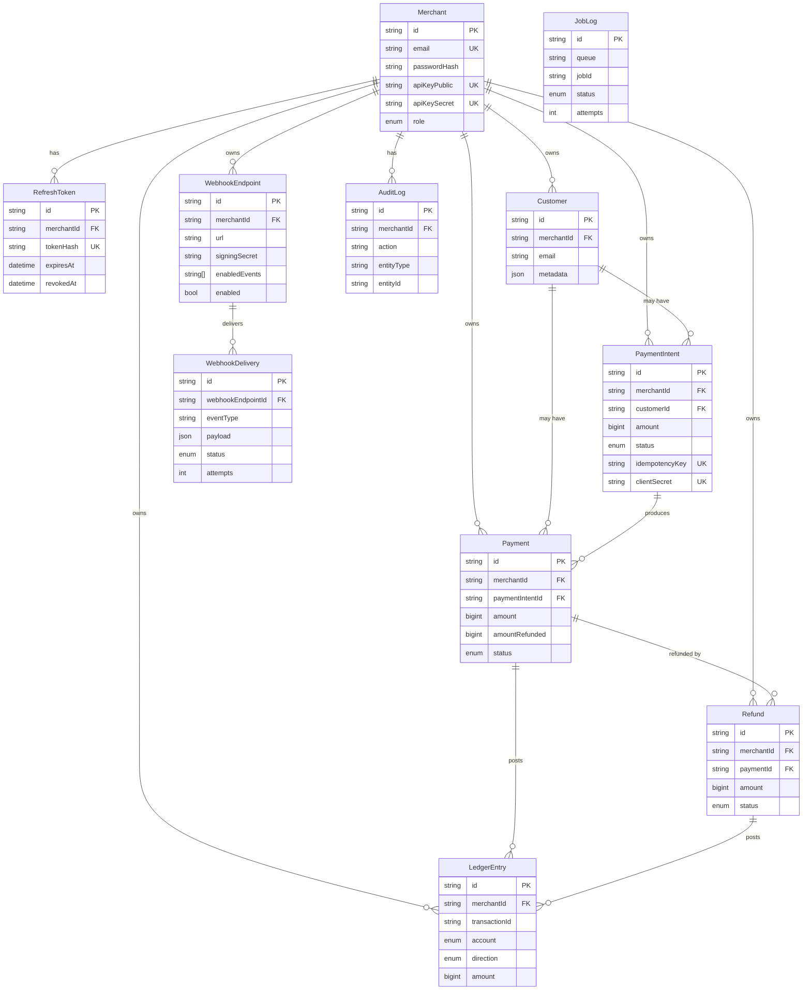

# Database

StripeForge uses **PostgreSQL 16** accessed through **Prisma**. The schema lives in
`backend/prisma/schema.prisma` — the single source of truth. This document documents
every table: its purpose, columns, relationships, indexes, constraints, and *why it
exists*.

Two design rules run through the whole schema:

- **Money is `BigInt` minor units.** Never a float. Precision is preserved end to end and
  the ledger reconciles exactly.
- **The ledger is append-only and double-entry.** Balances are *derived*, never stored as
  a mutable column.

## Entity-relationship diagram



## Enums

| Enum | Values |
| --- | --- |
| `MerchantRole` | `OWNER`, `ADMIN`, `VIEWER` |
| `PaymentIntentStatus` | `requires_payment_method`, `requires_confirmation`, `processing`, `succeeded`, `failed`, `canceled` |
| `PaymentStatus` | `pending`, `processing`, `succeeded`, `failed` |
| `RefundStatus` | `pending`, `succeeded`, `failed` |
| `LedgerDirection` | `DEBIT`, `CREDIT` |
| `LedgerAccount` | `MERCHANT_BALANCE`, `PLATFORM_FEES`, `CASH`, `REFUNDS_PAYABLE` |
| `WebhookDeliveryStatus` | `pending`, `succeeded`, `failed`, `dead` |
| `JobStatus` | `queued`, `active`, `completed`, `failed`, `dead` |

---

## Merchant (`merchants`)

**Purpose:** the top-level tenant. Every other record is scoped to a merchant.

**Columns:** `id` (uuid PK), `email` (unique), `passwordHash`, `name`, `role`
(`MerchantRole`, default `OWNER`), `emailVerified`, `emailVerifyToken?` (unique),
`passwordResetToken?` (unique), `passwordResetExpiresAt?`, `apiKeyPublic` (unique),
`apiKeySecret` (unique), `createdAt`, `updatedAt`.

**Relationships:** has many `Customer`, `PaymentIntent`, `Payment`, `Refund`,
`LedgerEntry`, `WebhookEndpoint`, `RefreshToken`, `AuditLog`.

**Indexes/constraints:** unique on `email`, `apiKeyPublic`, `apiKeySecret`,
`emailVerifyToken`, `passwordResetToken`.

**Why the table exists:** multi-tenancy. Scoping every query by `merchantId` isolates one
merchant's data from another's. It also holds the two authentication surfaces — password
(dashboard) and API key pair (server-to-server).

## RefreshToken (`refresh_tokens`)

**Purpose:** enable short-lived access tokens without forcing re-login, while remaining
revocable.

**Columns:** `id` (PK), `merchantId` (FK), `tokenHash` (unique), `expiresAt`,
`revokedAt?`, `createdAt`.

**Relationships:** belongs to `Merchant` (`onDelete: Cascade`).

**Indexes/constraints:** unique on `tokenHash`; index on `merchantId`.

**Why the table exists:** a stateless JWT can't be revoked. Storing only the **hash** of
an opaque refresh token means the server can rotate/revoke sessions and a DB leak never
exposes usable tokens. See [`security.md`](./security.md).

## Customer (`customers`)

**Purpose:** a buyer belonging to a merchant.

**Columns:** `id` (PK), `merchantId` (FK), `email`, `name?`, `phone?`, `metadata?` (JSON),
`createdAt`, `updatedAt`.

**Relationships:** belongs to `Merchant` (Cascade); has many `PaymentIntent`, `Payment`.

**Indexes/constraints:** **composite unique `(merchantId, email)`** — a customer email is
unique *per merchant*, not globally; index on `merchantId`.

**Why the table exists:** to associate payments with a recurring buyer and store
merchant-defined metadata, without leaking customers across tenants.

## PaymentIntent (`payment_intents`)

**Purpose:** tracks the lifecycle of collecting one payment (Stripe's PaymentIntent).

**Columns:** `id` (PK), `merchantId` (FK), `customerId?` (FK), `amount` (`BigInt`),
`currency` (default `usd`), `status` (`PaymentIntentStatus`, default
`requires_payment_method`), `description?`, `metadata?` (JSON), `idempotencyKey?`
(unique), `clientSecret` (unique), `createdAt`, `updatedAt`.

**Relationships:** belongs to `Merchant` (Cascade) and optionally `Customer`
(`onDelete: SetNull`); has many `Payment`.

**Indexes/constraints:** unique on `idempotencyKey` and `clientSecret`; indexes on
`merchantId`, `customerId`, `status`.

**Why the table exists:** it is the state machine of a payment (see
[`payment-lifecycle.md`](./payment-lifecycle.md)). The `idempotencyKey` makes create
retries safe; the `clientSecret` lets a client confirm the intent without exposing secret
keys.

## Payment (`payments`)

**Purpose:** a concrete capture attempt/record produced by confirming an intent.

**Columns:** `id` (PK), `merchantId` (FK), `paymentIntentId` (FK), `customerId?` (FK),
`amount` (`BigInt`), `currency`, `status` (`PaymentStatus`, default `pending`),
`amountRefunded` (`BigInt`, default `0`), `createdAt`, `updatedAt`.

**Relationships:** belongs to `Merchant` (Cascade), `PaymentIntent` (Cascade), optionally
`Customer` (SetNull); has many `Refund`, `LedgerEntry`.

**Indexes/constraints:** indexes on `merchantId`, `paymentIntentId`.

**Why the table exists:** an intent may have distinct capture records; the `Payment` is
what actually moves money and anchors ledger legs. `amountRefunded` enforces partial-
refund limits so refunds can never exceed the captured amount.

## Refund (`refunds`)

**Purpose:** a full or partial reversal of a captured payment.

**Columns:** `id` (PK), `merchantId` (FK), `paymentId` (FK), `amount` (`BigInt`),
`currency`, `status` (`RefundStatus`, default `pending`), `reason?`, `createdAt`,
`updatedAt`.

**Relationships:** belongs to `Merchant` (Cascade) and `Payment` (Cascade); has many
`LedgerEntry`.

**Indexes/constraints:** indexes on `merchantId`, `paymentId`.

**Why the table exists:** to record money going back out and to trigger reversing ledger
legs + a `refund.created` event. Keeping refunds as their own rows (rather than mutating
the payment) preserves history.

## LedgerEntry (`ledger_entries`)

**Purpose:** one leg of a balanced double-entry transaction. **Append-only.**

**Columns:** `id` (PK), `merchantId` (FK), `transactionId`, `account` (`LedgerAccount`),
`direction` (`LedgerDirection`), `amount` (`BigInt`), `currency`, `paymentId?` (FK),
`refundId?` (FK), `description?`, `createdAt`.

**Relationships:** belongs to `Merchant` (Cascade); optionally links `Payment`/`Refund`
(SetNull).

**Indexes/constraints:** indexes on `merchantId`, `transactionId`, `account`.

**Why the table exists:** it is the accounting core. Entries sharing a `transactionId`
must sum to zero (debits == credits), which makes the ledger self-auditing. Balances are
**derived** — e.g. merchant balance = `CREDIT − DEBIT` on `MERCHANT_BALANCE` — so there
is one source of truth and no cached balance can drift. Rows are never updated or deleted;
corrections are new compensating entries. The four accounts:

| Account | Meaning | On capture | On refund |
| --- | --- | --- | --- |
| `CASH` | Platform asset (funds held) | DEBIT (up) | CREDIT (down) |
| `MERCHANT_BALANCE` | Liability owed to merchant | CREDIT (up) | DEBIT (down) |
| `PLATFORM_FEES` | Platform revenue account | (reserved for fee splits) | — |
| `REFUNDS_PAYABLE` | Pending refund liability | — | (reserved) |

## WebhookEndpoint (`webhook_endpoints`)

**Purpose:** a merchant-registered URL to receive event notifications.

**Columns:** `id` (PK), `merchantId` (FK), `url`, `signingSecret`, `enabledEvents`
(`String[]`), `enabled` (default `true`), `createdAt`, `updatedAt`.

**Relationships:** belongs to `Merchant` (Cascade); has many `WebhookDelivery`.

**Indexes/constraints:** index on `merchantId`.

**Why the table exists:** to fan events out to merchant systems. The `signingSecret`
computes the HMAC signature header on each delivery; `enabledEvents` filters which events
this endpoint receives (empty = all). See [`webhooks.md`](./webhooks.md).

## WebhookDelivery (`webhook_deliveries`)

**Purpose:** the record of one attempt-tracked delivery of an event to an endpoint.

**Columns:** `id` (PK), `webhookEndpointId` (FK), `eventType`, `payload` (JSON), `status`
(`WebhookDeliveryStatus`, default `pending`), `attempts` (default `0`), `responseStatus?`,
`responseBody?`, `nextRetryAt?`, `createdAt`, `updatedAt`.

**Relationships:** belongs to `WebhookEndpoint` (Cascade).

**Indexes/constraints:** indexes on `webhookEndpointId`, `status`.

**Why the table exists:** durability + observability. Each delivery is persisted `pending`
*before* the job runs, so nothing is lost if the worker crashes; `attempts`/`status`/
`responseStatus`/`nextRetryAt` drive retries and the `dead` terminal state, and give the
dashboard a full delivery log.

## JobLog (`job_logs`)

**Purpose:** a persisted mirror of BullMQ job state for dashboard visibility.

**Columns:** `id` (PK), `queue`, `jobId`, `name`, `status` (`JobStatus`, default
`queued`), `attempts` (default `0`), `data?` (JSON), `error?`, `createdAt`, `updatedAt`.

**Relationships:** none (denormalised observability record).

**Indexes/constraints:** indexes on `queue`, `status`.

**Why the table exists:** BullMQ keeps job state in Redis, which is ephemeral and not
queryable from the API for reporting. `JobLog` gives a durable, SQL-queryable view of
queued/active/completed/failed/dead jobs for the Jobs dashboard. See
[`queues.md`](./queues.md).

## AuditLog (`audit_logs`)

**Purpose:** an immutable trail of security- and money-relevant actions.

**Columns:** `id` (PK), `merchantId?` (FK), `action`, `entityType?`, `entityId?`,
`metadata?` (JSON), `ipAddress?`, `createdAt`.

**Relationships:** optionally belongs to `Merchant` (SetNull, so logs survive merchant
deletion).

**Indexes/constraints:** indexes on `merchantId`, `action`.

**Why the table exists:** accountability. Records who did what (login, key rotation,
refund, endpoint change) with IP and metadata, for forensics and compliance-style review.
See [`security.md`](./security.md).

## Migrations & seeding

```bash
cd backend
npm run prisma:migrate     # dev: create + apply a migration
npm run prisma:deploy      # prod/CI: apply pending migrations
npm run seed               # demo merchant + sample data
npm run prisma:studio      # browse the DB
```
