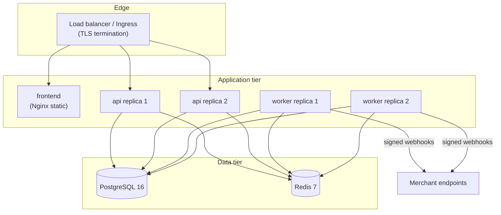

# Deployment

StripeForge ships as containers: a Postgres database, a Redis instance, the **API**, the
**worker**, and the **frontend** (static build served by Nginx). This document covers the
Docker images, the Compose topology, production configuration, migrations on deploy,
scaling workers, health checks, and graceful shutdown.

## Deployment topology



Key property: **API and worker are separate deployables** that share the same image and
DB/Redis but run different commands. You scale them independently — more API replicas for
request load, more worker replicas for job throughput.

## Docker images

Both API and worker build from `backend/Dockerfile` (multi-stage: install → `tsc` build →
slim runtime running `node dist/...`). The frontend builds from `frontend/Dockerfile`
(Vite build → Nginx serving static assets, `frontend/nginx.conf`).

| Deployable | Image source | Command |
| --- | --- | --- |
| `api` | `./backend` | `npx prisma migrate deploy && node dist/server.js` |
| `worker` | `./backend` | `node dist/workers/index.js` |
| `frontend` | `./frontend` | Nginx serving `dist/` on port 80 |

## docker-compose services

`docker-compose.yml` (repo root) defines the full local/prod-like stack:

| Service | Image / build | Ports | Depends on | Notes |
| --- | --- | --- | --- | --- |
| `postgres` | `postgres:16-alpine` | `5432` | — | Volume `pgdata`, `pg_isready` healthcheck |
| `redis` | `redis:7-alpine` | `6379` | — | `redis-cli ping` healthcheck |
| `api` | build `./backend` | `4000` | postgres+redis healthy | Runs migrations then starts |
| `worker` | build `./backend` | — | postgres+redis healthy | Consumes queues |
| `frontend` | build `./frontend` | `5173→80` | api | Static SPA |

```bash
docker compose up --build            # full stack
docker compose up -d postgres redis  # infra only (for manual dev)
docker compose up -d --scale worker=3  # run 3 worker replicas
```

## Production environment

Set these via your platform's secret/env management (never commit them). Minimum:

| Variable | Prod guidance |
| --- | --- |
| `NODE_ENV` | `production` |
| `DATABASE_URL` | Managed Postgres URL (use connection pooling, e.g. PgBouncer) |
| `REDIS_HOST` / `REDIS_PORT` | Managed Redis (persistence enabled) |
| `JWT_ACCESS_SECRET` / `JWT_REFRESH_SECRET` | Strong, unique, rotated secrets |
| `CORS_ORIGINS` | Your real frontend origin(s) only |
| `RATE_LIMIT_*` | Tune per traffic |
| `WEBHOOK_MAX_ATTEMPTS` | Delivery attempt cap |
| `LOG_LEVEL` | `info` (or `warn`) |

`src/config/env.ts` validates all of these at boot and **exits** on a bad config, so a
misconfigured deploy fails fast instead of erroring mid-request.

## Migrations on deploy

Migrations run with `prisma migrate deploy` (idempotent, applies pending migrations only —
never generates new ones in prod). Two patterns:

1. **Inline (Compose default):** the `api` container runs `prisma migrate deploy` before
   `node dist/server.js`. Simple; fine for single-replica.
2. **Dedicated migration step (recommended at scale):** run `prisma migrate deploy` as a
   one-off job/init container **before** rolling out API/worker replicas, so multiple
   replicas don't race to migrate. Then start app containers with the migration disabled.

## Scaling workers

- Workers are stateless consumers of Redis queues — add replicas to increase throughput.
- BullMQ distributes jobs across all workers on a queue; concurrency per worker is
  configurable in the worker setup.
- Watch queue depth and the `JobLog`/dead counts (see [`queues.md`](./queues.md)) to
  decide when to scale. Webhook spikes (many merchants, many events) are the usual driver.

## Health checks

- **API:** `GET /health` returns `{ status: "ok", uptime }`. Wire it to your liveness/
  readiness probes and the load balancer.
- **Postgres / Redis:** Compose healthchecks (`pg_isready`, `redis-cli ping`) gate startup
  ordering; in Kubernetes use equivalent probes.
- **Worker:** has no HTTP surface; monitor via process liveness + queue metrics + JobLog.

## Graceful shutdown

Both processes handle `SIGTERM`/`SIGINT` so a rolling deploy doesn't drop work:

- **API (`src/server.ts`):** stop accepting new connections, let in-flight requests
  finish, then close the Prisma and Redis connections, then exit.
- **Worker:** stop pulling new jobs, let the current job(s) complete (BullMQ `worker.close()`
  waits for active jobs up to a grace period), then disconnect and exit.

Because webhook deliveries are persisted `pending` before running and jobs are retried, a
worker killed mid-flight loses no events — the job is retried by another worker.

## Operational checklist

- [ ] Secrets injected via env/secret manager, not files.
- [ ] `prisma migrate deploy` runs (inline or as a pre-deploy job).
- [ ] Postgres backups + PITR configured.
- [ ] Redis persistence (AOF/RDB) enabled so queued jobs survive a restart.
- [ ] Health probes wired for API; process/queue monitoring for workers.
- [ ] Log aggregation on pino output; alerts on dead-letter growth.
- [ ] TLS terminated at the edge; `trust proxy` already set in the app.
