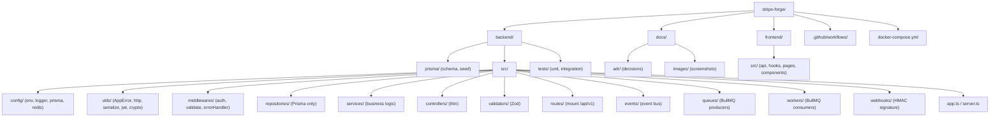

# Folder Structure

An annotated tour of the whole StripeForge monorepo — one line of purpose per folder.

## Top level

```text
stripe-forge/
├── backend/                  # Express API + BullMQ worker (TypeScript, Prisma, Redis)
├── frontend/                 # React 18 + Vite + Tailwind dashboard SPA
├── docs/                     # architecture / module / reference docs
│   ├── adr/                  # Architecture Decision Records
│   └── images/               # screenshots for the README (place PNGs here)
├── .github/workflows/        # CI (typecheck, lint, test, build)
├── docker-compose.yml        # postgres · redis · api · worker · frontend
├── .editorconfig             # cross-editor whitespace rules
├── .prettierrc               # shared Prettier config
├── .eslintrc.json            # shared ESLint config (backend)
├── .gitignore
├── CONTRIBUTING.md
├── LICENSE                   # MIT
└── README.md
```

## Backend

```text
backend/
├── prisma/
│   ├── schema.prisma         # data model — single source of truth
│   └── seed.ts               # demo merchant + sample data
├── src/
│   ├── config/               # boot-time singletons, read from env
│   │   ├── env.ts            # zod-validated process.env → typed `env`
│   │   ├── logger.ts         # pino logger
│   │   ├── prisma.ts         # PrismaClient singleton
│   │   └── redis.ts          # ioredis + BullMQ connection options
│   ├── utils/                # cross-cutting helpers (no I/O beyond crypto)
│   │   ├── AppError.ts       # typed error classes → status/code envelope
│   │   ├── http.ts           # asyncHandler, ok, paginated, parsePagination
│   │   ├── serialize.ts      # BigInt → number at the API boundary
│   │   ├── jwt.ts            # access/refresh token helpers
│   │   ├── crypto.ts         # token / API-key generation, sha256
│   │   ├── password.ts       # bcrypt hash/compare
│   │   └── audit.ts          # write AuditLog entries
│   ├── middlewares/          # Express middleware
│   │   ├── auth.ts           # requireAuth, requireRole
│   │   ├── validate.ts       # Zod request validation
│   │   └── errorHandler.ts   # notFound + central error handler (mounted last)
│   ├── repositories/         # *.repository.ts — Prisma-only data access
│   ├── services/             # *.service.ts — business logic, transactions, invariants
│   ├── controllers/          # *.controller.ts — thin handlers (parse → call → respond)
│   ├── validators/           # *.validator.ts — Zod schemas per module
│   ├── routes/               # *.routes.ts + index.ts (mounts under /api/v1)
│   ├── events/               # domain event bus + fan-out + enqueue helpers
│   ├── queues/               # queue.names.ts + producers (addWebhookJob, …)
│   ├── workers/              # BullMQ worker process (webhook/receipt/email)
│   ├── webhooks/             # signature.ts — HMAC sign/verify
│   ├── types/                # express.d.ts augmentation, job types
│   ├── app.ts                # createApp() — Express app factory
│   └── server.ts             # HTTP bootstrap + graceful shutdown
├── tests/
│   ├── unit/                 # pure, fast tests (no DB/Redis)
│   ├── integration/          # HTTP tests vs real app (skipped by default)
│   ├── README.md             # why each test exists
│   └── ...
├── vitest.config.ts          # test runner config
├── tsconfig.json             # strict TS, CommonJS output
├── package.json
├── .env.example              # documents required env (no secrets)
└── Dockerfile                # builds both api and worker
```

## Frontend

```text
frontend/
├── index.html                # Vite entry
├── vite.config.ts            # dev proxy /api → :4000
├── tailwind.config.js        # design tokens
├── postcss.config.js
├── nginx.conf                # prod static serving config
├── Dockerfile                # Vite build → Nginx
├── src/
│   ├── main.tsx              # React root + providers + router
│   ├── App.tsx               # layout + routes
│   ├── api/                  # Axios client (auth/refresh interceptors) + endpoints
│   ├── hooks/                # React Query hooks
│   ├── pages/                # route-level screens
│   ├── components/           # reusable UI
│   ├── context/              # AuthContext
│   ├── lib/                  # helpers (money formatting, classnames)
│   └── types/                # DTO types mirroring the API
└── .env.example              # VITE_API_BASE_URL
```

## Diagram



See [`architecture.md`](./architecture.md) for how these pieces interact at runtime and
[`backend.md`](./backend.md) for the layering conventions.
