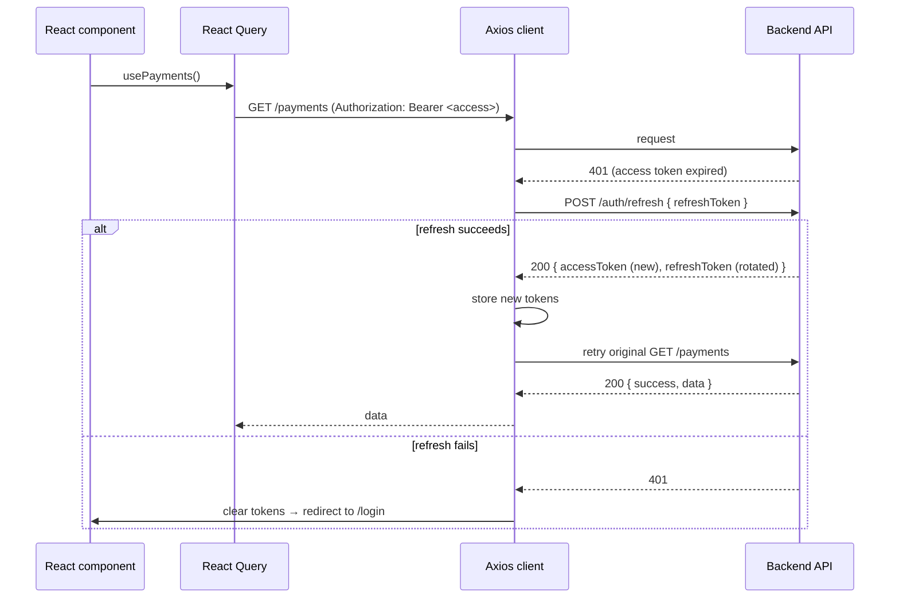

# Frontend Guide

The StripeForge dashboard is a **React 18 + Vite + TypeScript** single-page app styled
with **Tailwind CSS**. It talks to the backend API (`/api/v1`) using **Axios** + **React
Query** and visualises data with **Recharts**. This guide describes the app structure,
the data-fetching layer, the auth/token-refresh flow, routing, and the UI system.

> The frontend is scaffolded (Vite, Tailwind, TS configured). The structure below is the
> intended, conventional layout; adapt paths to what exists as the app grows.

## App structure

```text
frontend/
├── index.html                 # Vite entry HTML
├── vite.config.ts             # dev proxy: /api → http://localhost:4000
├── tailwind.config.js         # design tokens (colors, spacing)
├── src/
│   ├── main.tsx               # React root, QueryClientProvider, Router
│   ├── App.tsx                # top-level layout + routes
│   ├── api/
│   │   ├── client.ts          # Axios instance + interceptors (auth, refresh)
│   │   └── endpoints.ts       # typed API call functions
│   ├── hooks/                 # React Query hooks (useCustomers, usePayments, …)
│   ├── pages/                 # route-level screens (Dashboard, Payments, Ledger, …)
│   ├── components/            # reusable UI (Table, Badge, Card, StatusPill, …)
│   ├── context/               # AuthContext (tokens, current merchant)
│   ├── lib/                   # helpers (money formatting, clsx/tailwind-merge)
│   └── types/                 # shared TS types mirroring API DTOs
└── src/vite-env.d.ts
```

## Data fetching with React Query

All server state is owned by **React Query** (`@tanstack/react-query`) — the frontend
does **not** duplicate server data in local state. This gives caching, background
refetching, retries, and request de-duplication for free. See
[ADR-006](./adr/006-react-query.md).

A conventional hook wraps an endpoint call and a stable query key:

```ts
// src/hooks/usePayments.ts
import { useQuery } from '@tanstack/react-query';
import { listPayments } from '../api/endpoints';

export function usePayments(page = 1) {
  return useQuery({
    queryKey: ['payments', page],
    queryFn: () => listPayments(page),
    staleTime: 30_000,
  });
}
```

Mutations invalidate the relevant keys so lists refresh automatically:

```ts
// src/hooks/useCreateRefund.ts
import { useMutation, useQueryClient } from '@tanstack/react-query';
import { createRefund } from '../api/endpoints';

export function useCreateRefund() {
  const qc = useQueryClient();
  return useMutation({
    mutationFn: createRefund,
    onSuccess: () => {
      qc.invalidateQueries({ queryKey: ['refunds'] });
      qc.invalidateQueries({ queryKey: ['ledger'] });
    },
  });
}
```

Endpoint functions unwrap the API envelope (`{ success, data }`) so hooks return `data`
directly:

```ts
// src/api/endpoints.ts
import { client } from './client';
export async function listPayments(page: number) {
  const res = await client.get('/payments', { params: { page } });
  return res.data.data; // unwrap { success, data, meta }
}
```

## Auth & token-refresh flow

Access tokens are short-lived (default 15 min); refresh tokens are longer-lived and
**rotating**. The Axios client transparently refreshes an expired access token so the UI
never sees a spurious logout.



Implementation sketch (`src/api/client.ts`):

```ts
import axios from 'axios';

export const client = axios.create({ baseURL: import.meta.env.VITE_API_BASE_URL });

// Attach the current access token to every request.
client.interceptors.request.use((config) => {
  const token = getAccessToken();
  if (token) config.headers.Authorization = `Bearer ${token}`;
  return config;
});

// On a 401, try ONE refresh, then replay the original request. A single-flight
// guard prevents a burst of 401s from firing many concurrent refreshes.
let refreshing: Promise<void> | null = null;
client.interceptors.response.use(
  (r) => r,
  async (error) => {
    const original = error.config;
    if (error.response?.status === 401 && !original._retried) {
      original._retried = true;
      refreshing ??= doRefresh().finally(() => (refreshing = null));
      try {
        await refreshing;
        return client(original);
      } catch {
        clearTokens();
        window.location.assign('/login');
      }
    }
    return Promise.reject(error);
  },
);
```

Tokens live in an `AuthContext`; on refresh both the access and (rotated) refresh token
are replaced. The rotation + revocation model is described in
[`security.md`](./security.md).

## Routing

Routing uses **react-router-dom v6**. Protected routes are wrapped in a guard that checks
for a valid session (and can `requireRole` on the client for UX — the server always
re-checks):

```tsx
// src/App.tsx (sketch)
<Routes>
  <Route path="/login" element={<Login />} />
  <Route element={<RequireAuth />}>
    <Route path="/" element={<Dashboard />} />
    <Route path="/customers" element={<Customers />} />
    <Route path="/payments" element={<Payments />} />
    <Route path="/refunds" element={<Refunds />} />
    <Route path="/ledger" element={<Ledger />} />
    <Route path="/webhooks" element={<Webhooks />} />
    <Route path="/jobs" element={<Jobs />} />
  </Route>
  <Route path="*" element={<NotFound />} />
</Routes>
```

## UI system

- **Tailwind CSS** utility classes with design tokens in `tailwind.config.js`
  ([ADR-007](./adr/007-tailwind.md)).
- `clsx` + `tailwind-merge` for conditional/merged class names.
- `lucide-react` for icons.
- **Recharts** for charts (payment volume, success rate, balance over time).
- Money is formatted from **minor units → display currency** in one place
  (`src/lib/money.ts`), mirroring the backend's minor-unit convention:

  ```ts
  export const formatMoney = (minor: number, currency = 'USD') =>
    new Intl.NumberFormat('en-US', { style: 'currency', currency }).format(minor / 100);
  ```

## Dev proxy & environment

- `vite.config.ts` proxies `/api` → `http://localhost:4000` in dev so there are no CORS
  issues locally.
- Production builds read `VITE_API_BASE_URL` (see `frontend/.env.example`).
- Build: `npm run build` (`tsc && vite build`); the Docker image serves the static output
  via Nginx.
