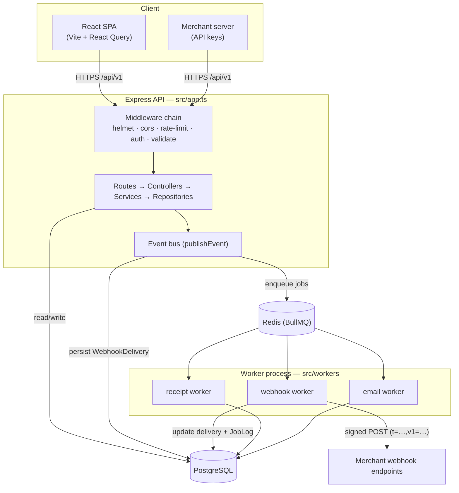
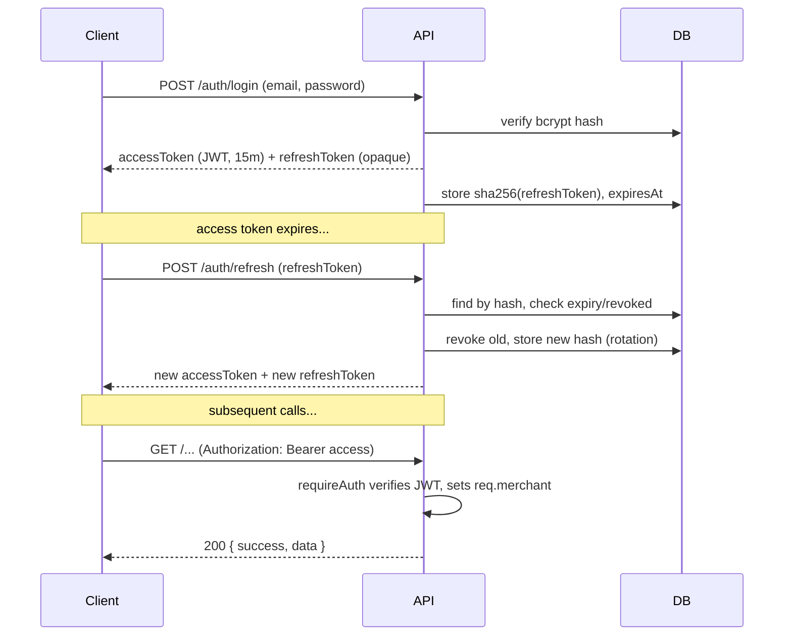
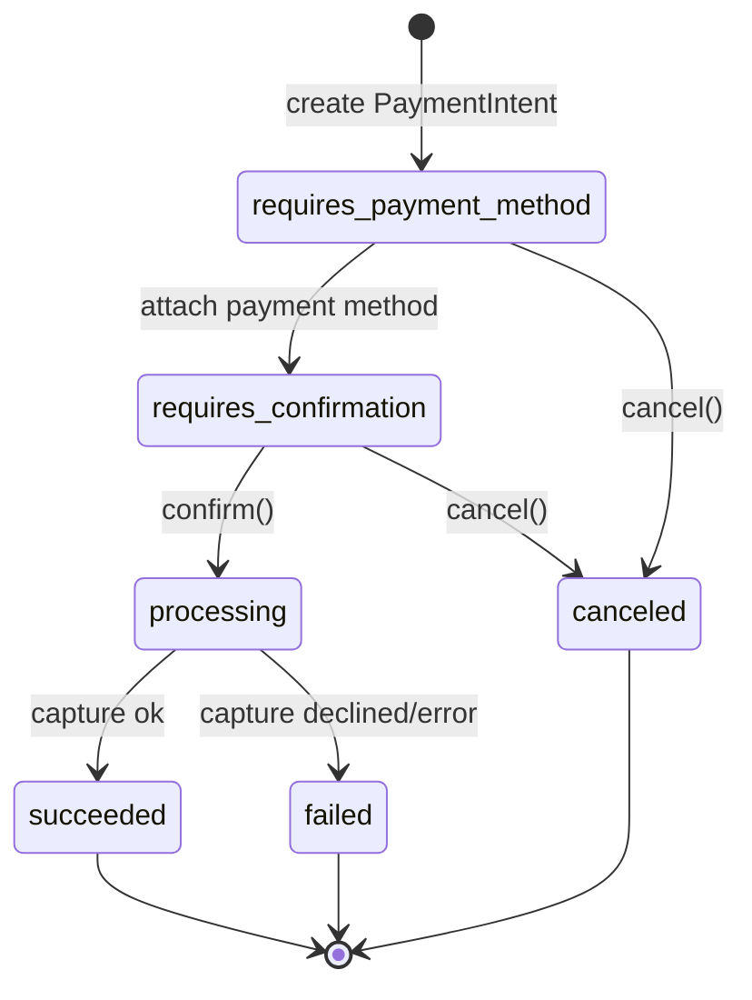
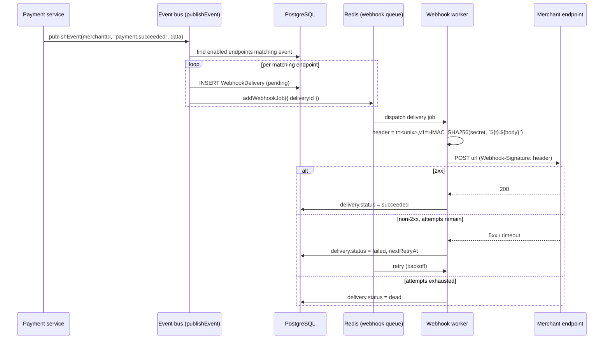
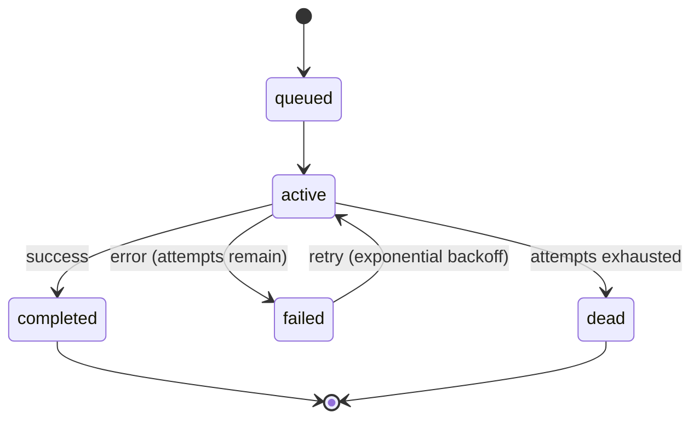
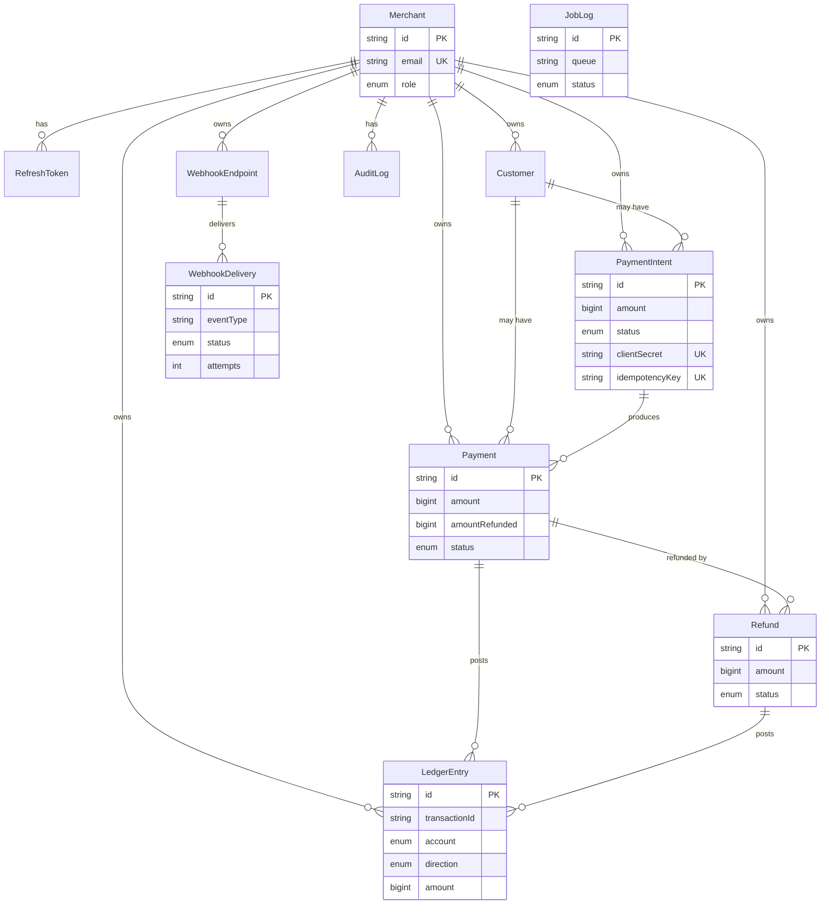
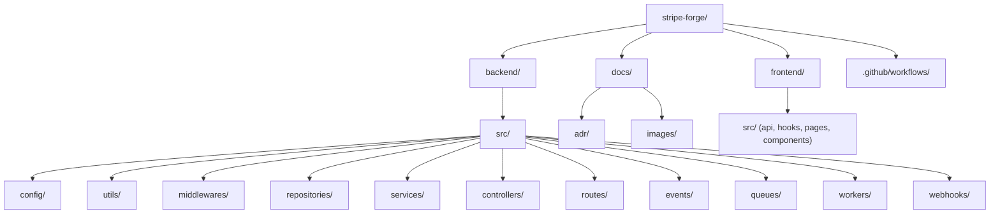
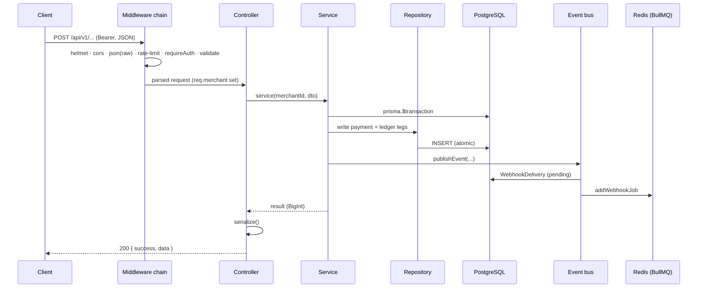
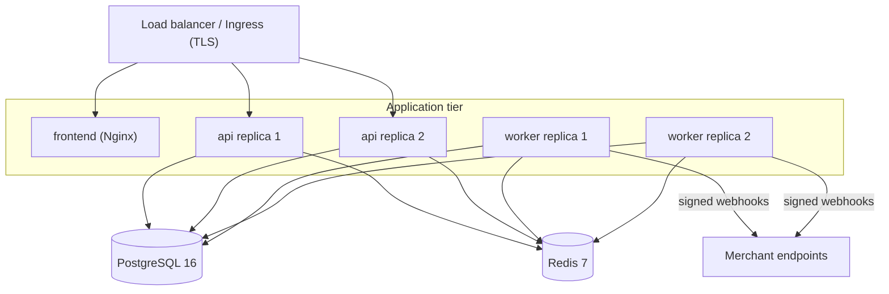

# Diagram Index

Every StripeForge diagram, collected in one place. Each also appears in the topical doc
noted beside it. All are valid [Mermaid](https://mermaid.js.org/).

- [System Architecture](#system-architecture) · [`architecture.md`](./architecture.md)
- [Authentication Flow](#authentication-flow) · [`security.md`](./security.md)
- [Payment Lifecycle](#payment-lifecycle) · [`payment-lifecycle.md`](./payment-lifecycle.md)
- [Webhook Flow](#webhook-flow) · [`webhooks.md`](./webhooks.md)
- [Queue Processing](#queue-processing) · [`queues.md`](./queues.md)
- [Database ER Diagram](#database-er-diagram) · [`database.md`](./database.md)
- [Folder Structure](#folder-structure) · [`folder-structure.md`](./folder-structure.md)
- [Request Lifecycle](#request-lifecycle) · [`architecture.md`](./architecture.md)
- [Deployment](#deployment) · [`deployment.md`](./deployment.md)

---

## System Architecture

## Authentication Flow

## Payment Lifecycle

## Webhook Flow

## Queue Processing

## Database ER Diagram

## Folder Structure

## Request Lifecycle

## Deployment

