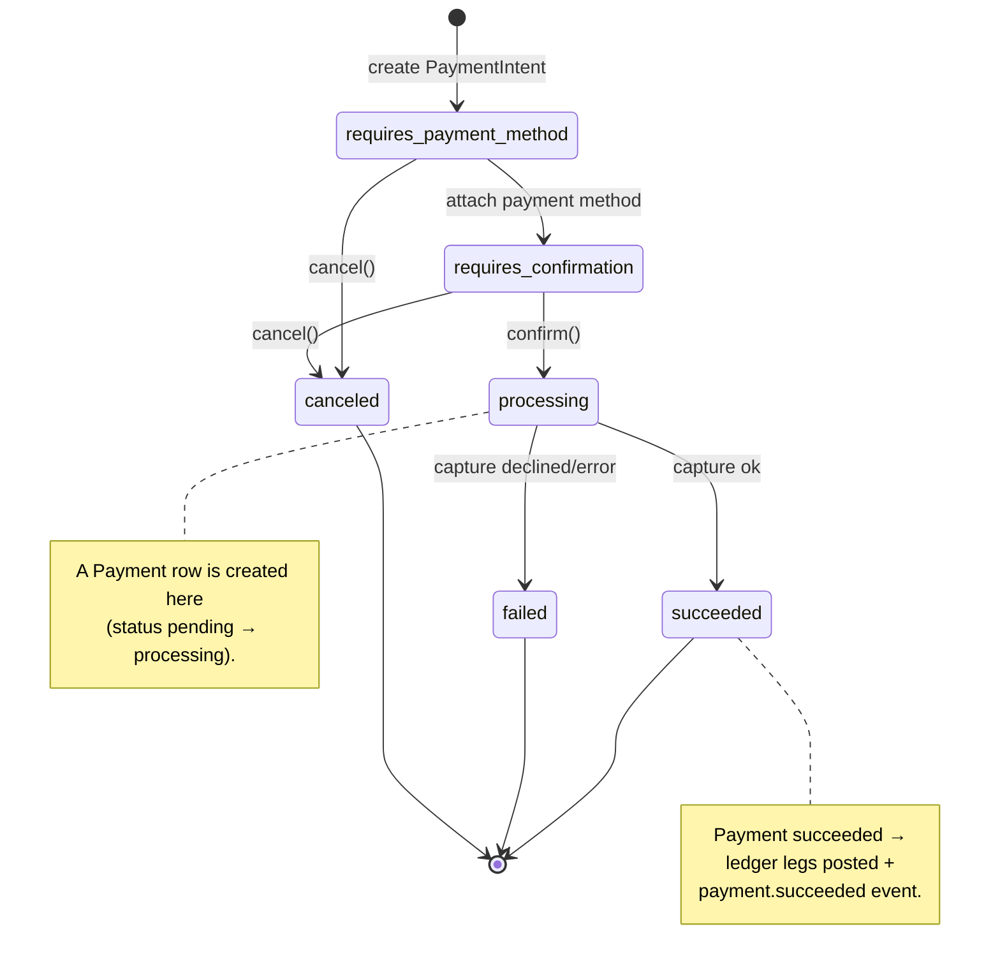
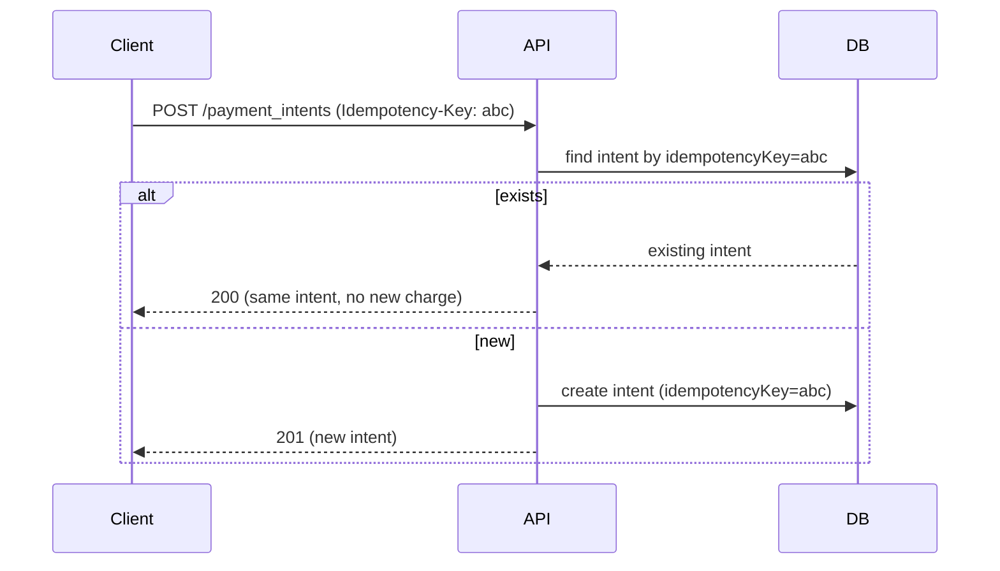
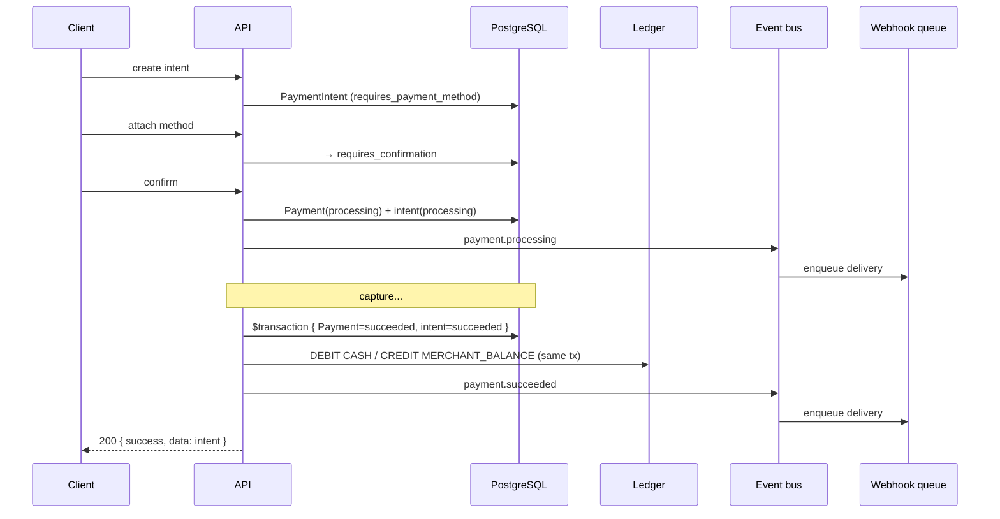

# Payment Lifecycle

A **PaymentIntent** is the object that tracks the full journey of collecting a payment,
mirroring Stripe's model (simplified). It moves through a small, well-defined state
machine; at each transition StripeForge writes the right database rows, posts
double-entry **ledger** legs, publishes domain **events**, and (via the queue) delivers
signed **webhooks**. This document is the single reference for *what happens when*.

## State machine

The enum values (from `schema.prisma`) are:
`requires_payment_method`, `requires_confirmation`, `processing`, `succeeded`, `failed`,
`canceled`. `succeeded`, `failed`, and `canceled` are **terminal**.

## Valid transitions

| From | Event / action | To | Notes |
| --- | --- | --- | --- |
| — | `POST /payment_intents` | `requires_payment_method` | Initial state; `clientSecret` issued |
| `requires_payment_method` | attach payment method | `requires_confirmation` | (Simulated) card details attached |
| `requires_confirmation` | `POST /payment_intents/:id/confirm` | `processing` | Creates a `Payment` (status `processing`) |
| `processing` | capture succeeds | `succeeded` | Ledger legs + `payment.succeeded` |
| `processing` | capture fails | `failed` | `payment.failed` |
| `requires_payment_method` / `requires_confirmation` | `POST /payment_intents/:id/cancel` | `canceled` | No money moved |

Any transition not in this table is rejected by the service with a `ConflictError` (or
`BadRequestError`) — the state machine is enforced server-side, never trusted from the
client.

## Idempotency

Client retries (network blips, double-clicks) must **never** double-charge. Two
mechanisms guard this:

1. **PaymentIntent `idempotencyKey`** — a `@unique` column. A create request carrying an
   `Idempotency-Key` header is tied to a single logical PaymentIntent. A retried create
   with the same key returns the **existing** intent instead of making a new one.
2. **State-machine guards** — because transitions are validated, confirming an intent
   that is already `succeeded`/`processing` is a no-op/rejected, not a second capture. The
   `Payment.amountRefunded` column similarly caps refunds so partial refunds can't exceed
   the captured amount.

## What fires at each step

The tables below show the **DB writes**, **ledger legs**, **events**, and **webhooks** at
each transition. Ledger sign convention (see [`database.md`](./database.md) &
`ledger.service.ts`): `MERCHANT_BALANCE` is a liability (CREDIT increases it); `CASH` is
an asset (DEBIT increases it). Every transaction's debits equal its credits.

### 1. Create PaymentIntent → `requires_payment_method`

| Aspect | What happens |
| --- | --- |
| DB | Insert `PaymentIntent` (amount as `BigInt`, `clientSecret`, optional `idempotencyKey`, status `requires_payment_method`) |
| Ledger | none (no money has moved) |
| Event | none |
| Webhook | none |

### 2. Attach method → `requires_confirmation`

| Aspect | What happens |
| --- | --- |
| DB | Update `PaymentIntent.status = requires_confirmation` |
| Ledger | none |
| Event | none |
| Webhook | none |

### 3. Confirm → `processing`

| Aspect | What happens |
| --- | --- |
| DB | Update intent → `processing`; **create `Payment`** (status `processing`) |
| Ledger | none yet (funds not settled) |
| Event | `payment.processing` |
| Webhook | `payment.processing` delivered to subscribed endpoints |

### 4. Capture succeeds → `succeeded`

All writes happen inside a **single `prisma.$transaction`** so the payment status and its
ledger legs commit atomically.

| Aspect | What happens |
| --- | --- |
| DB | `Payment.status = succeeded`; intent `status = succeeded` |
| Ledger | Two legs, one `transactionId`: **DEBIT `CASH`** (asset up) + **CREDIT `MERCHANT_BALANCE`** (we owe the merchant) — equal amounts, balanced |
| Event | `payment.succeeded` |
| Webhook | `payment.succeeded` |

### 5. Capture fails → `failed`

| Aspect | What happens |
| --- | --- |
| DB | `Payment.status = failed`; intent `status = failed` |
| Ledger | none (no funds moved) |
| Event | `payment.failed` |
| Webhook | `payment.failed` |

### 6. Cancel (from `requires_*`) → `canceled`

| Aspect | What happens |
| --- | --- |
| DB | `PaymentIntent.status = canceled` |
| Ledger | none |
| Event | none (no `payment.canceled` webhook type in this build) |
| Webhook | none |

### Refund (on a `succeeded` payment)

Refunds operate on a `Payment`, not the intent. Full or partial, capped by
`Payment.amountRefunded`.

| Aspect | What happens |
| --- | --- |
| DB | Insert `Refund` (status → `succeeded`); increment `Payment.amountRefunded` |
| Ledger | Reversing legs (new `transactionId`): **DEBIT `MERCHANT_BALANCE`** + **CREDIT `CASH`** — balanced |
| Event | `refund.created` |
| Webhook | `refund.created` |

> Corrections are always **additive** — the ledger is append-only. A refund posts *new*
> compensating legs; it never edits the original capture's entries.

## End-to-end happy path

## Related docs

- Ledger model & accounts → [`database.md`](./database.md)
- Events → webhooks fan-out → [`webhooks.md`](./webhooks.md)
- Queue delivery/retries → [`queues.md`](./queues.md)
- API request/response for each endpoint → [`api.md`](./api.md)
