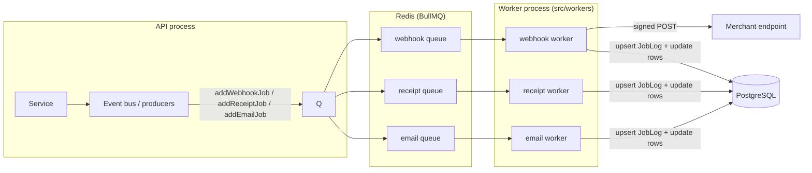
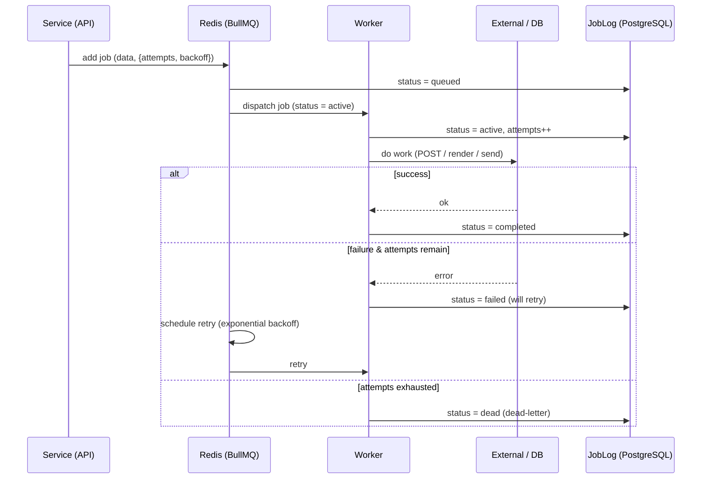
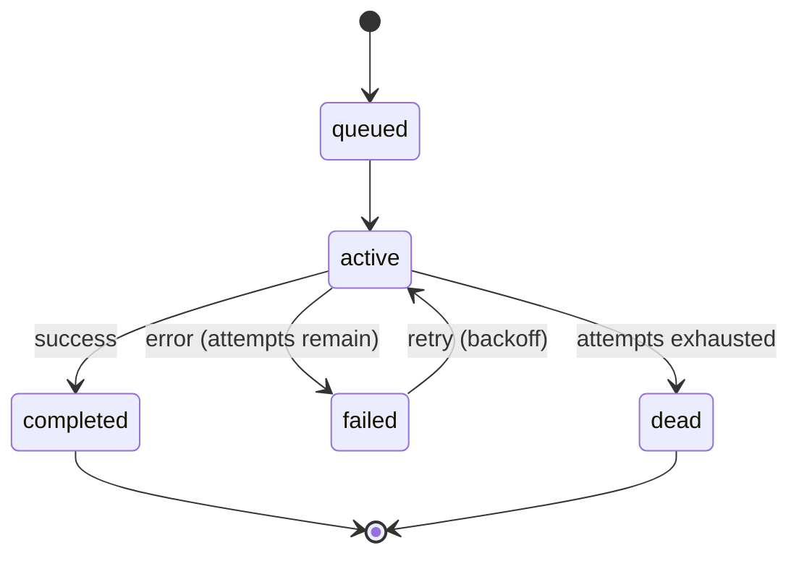

# Queues & Background Processing

StripeForge does slow or unreliable work **off the request path** using
[BullMQ](https://docs.bullmq.io/) backed by Redis. The API enqueues jobs and returns
immediately; a **separate worker process** consumes them with retries, backoff, and a
dead-letter path. Job state is mirrored into the `JobLog` table so the dashboard can see
what's happening.

## Why a queue at all

Delivering a webhook, rendering a receipt, or sending an email can be slow and can fail
(the merchant's endpoint might be down). Doing that work synchronously inside a request
would make payments slow and couple their success to third-party availability. A queue
gives us: **low request latency**, **durability** (jobs survive an API restart),
**automatic retries with backoff**, and **isolation** (a flood of webhooks can't starve
the API — you scale workers independently). See [ADR-004](./adr/004-bullmq.md) and
[ADR-005](./adr/005-redis.md).

## The three queues

Names are the single source of truth in `src/queues/queue.names.ts`:

| Constant | Name | Produced by | What the worker does |
| --- | --- | --- | --- |
| `QUEUE_NAMES.WEBHOOK` | `webhook` | event bus (`addWebhookJob`) | Sign + POST an event to a merchant endpoint; record the delivery result |
| `QUEUE_NAMES.RECEIPT` | `receipt` | payment service (`addReceiptJob`) | Generate a payment receipt artifact |
| `QUEUE_NAMES.EMAIL` | `email` | services (`addEmailJob`) | Send transactional email (verify, receipt, alerts) |

Producers are exported from `src/queues/index.ts`: `addWebhookJob(data)`,
`addReceiptJob(data)`, `addEmailJob(data)`. Services call these — they never talk to the
worker directly.

## Architecture



## Job processing lifecycle



## Retry & backoff

Each job is added with BullMQ retry options, e.g.:

```ts
await webhookQueue.add('deliver', { deliveryId }, {
  attempts: env.WEBHOOK_MAX_ATTEMPTS,     // default 5
  backoff: { type: 'exponential', delay: 1000 }, // 1s, 2s, 4s, 8s, ...
  removeOnComplete: 1000,   // keep recent history, cap Redis growth
  removeOnFail: false,      // keep failed jobs for inspection
});
```

- **`attempts`** caps total tries. For webhooks it is driven by `WEBHOOK_MAX_ATTEMPTS`.
- **Exponential backoff** spaces out retries so a briefly-down endpoint recovers without
  being hammered, and a thundering-herd of failures is spread over time.
- **Idempotency:** because a delivery is keyed by its persisted `WebhookDelivery` row,
  re-running the same job re-sends the same event id — merchants deduplicate on the event
  id (Stripe-style), so retries are safe.

## Dead-letter handling

When a job exhausts its attempts:

1. BullMQ moves it to its **failed** set (kept, since `removeOnFail: false`).
2. The worker's failure handler marks the corresponding `JobLog.status = dead` and, for
   webhooks, sets `WebhookDelivery.status = dead`.
3. Dead items are **not** silently dropped — they are visible on the Jobs / Webhook
   Deliveries dashboards and can be manually re-driven.



This mirrors the `JobStatus` enum (`queued/active/completed/failed/dead`) and, for
deliveries, the `WebhookDeliveryStatus` enum (`pending/succeeded/failed/dead`).

## Observability: JobLog

BullMQ keeps live job state in Redis, which is ephemeral and awkward to query for
reporting. The workers **mirror** each transition into the `JobLog` table
(`queue`, `jobId`, `name`, `status`, `attempts`, `data`, `error`). This gives a durable,
SQL-queryable feed for `GET /api/v1/jobs` and the dashboard — e.g. "how many `webhook`
jobs are `dead` in the last 24h?". See [`database.md`](./database.md#joblog-job_logs).

## Running the worker

```bash
cd backend
npm run worker          # dev (tsx)
npm run worker:prod     # prod (node dist/workers/index.js)
```

The worker is a **separate process** from the API (own container in Compose) so it can be
scaled and restarted independently. Graceful shutdown (SIGTERM) lets in-flight jobs finish
before exit — see [`deployment.md`](./deployment.md).
