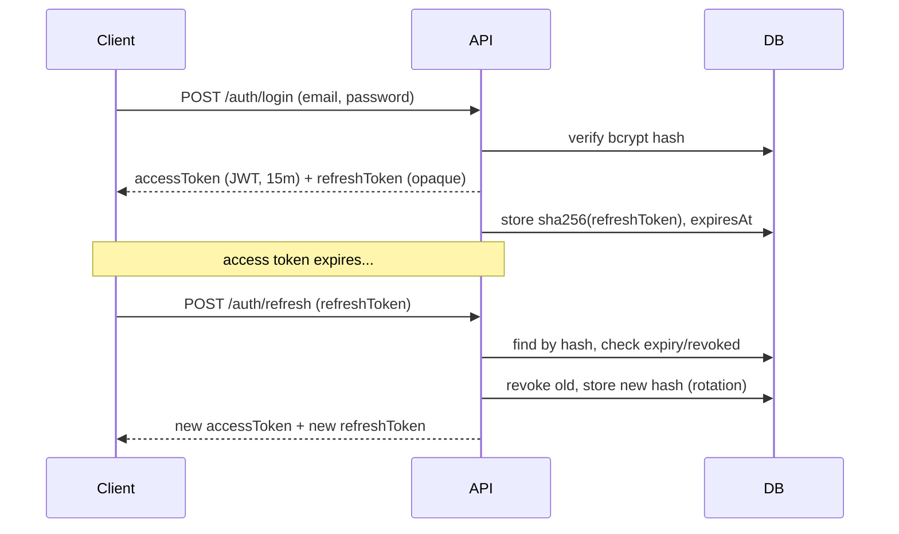

# Security

This document describes the security model of StripeForge and, just as importantly, its
**known gaps**. StripeForge is an **educational** project: it demonstrates the *shape* of
a secure payments backend but is **not PCI-compliant** and must never handle real card
data (see the [PCI note](#pci-note)).

## Authentication

### Passwords (bcrypt)

Merchant passwords are hashed with **bcrypt** (`bcryptjs`) via `src/utils/password.ts`.
bcrypt is deliberately slow and salted per-hash, which resists brute-force and rainbow-
table attacks. Plaintext passwords are never stored or logged.

### Access tokens (JWT)

- On login, the server issues a **short-lived JWT access token** (default TTL 900s /
  15 min) signed with `JWT_ACCESS_SECRET`.
- Payload: `{ sub: merchantId, email, role }` (see `src/utils/jwt.ts`).
- `requireAuth` (`src/middlewares/auth.ts`) verifies the `Authorization: Bearer <token>`
  header, and on success sets `req.merchant = { id, email, role }`.
- Access tokens are **stateless** — fast to verify, but cannot be individually revoked
  before expiry. That's the trade-off that motivates refresh tokens.

### Refresh tokens + rotation

- Refresh tokens are **opaque random strings** (not JWTs), generated with a CSPRNG.
- Only the **SHA-256 hash** is stored (`RefreshToken.tokenHash`), so a database leak never
  yields usable tokens.
- On `POST /auth/refresh` the presented token is looked up by hash, checked for expiry and
  `revokedAt`, then **rotated**: the old token is revoked and a new one issued. Reuse of a
  revoked token is a signal of theft and should invalidate the session family.
- `POST /auth/logout` revokes the refresh token.

### API key pair (server-to-server)

Each merchant gets a Stripe-style **public/secret** key pair
(`pk_test_… / sk_test_…`, `src/utils/crypto.ts`). The secret is shown once. Public keys
are safe client-side; secret keys authenticate server-to-server calls. Keys are stored
uniquely per merchant and can be rotated.

## Authorization

- `requireAuth` gates protected routes.
- `requireRole(...roles)` enforces role-based access (`OWNER`/`ADMIN`/`VIEWER`) — e.g.
  `VIEWER` can read but not create refunds.
- **Every** service query is scoped by `merchantId` (multi-tenant isolation, below).

## Multi-tenant isolation

`Merchant` is the tenant boundary. Every other table carries a `merchantId`, and services
always filter by the authenticated merchant's id (from `req.merchant.id`) — never by an id
taken from the request body/params without an ownership check. This prevents one merchant
from reading or mutating another's customers, payments, or ledger. Composite constraints
like `Customer(merchantId, email)` reinforce that identifiers are unique *per tenant*, not
globally.

> Rule of thumb enforced in review: a repository query that can return another tenant's
> row is a bug. `findById` is always paired with a `merchantId` check in the service.

## Idempotency

Client retries must not double-charge. `PaymentIntent.idempotencyKey` is `@unique`; a
create carrying an `Idempotency-Key` header returns the existing intent on retry. Webhook
consumers deduplicate on the event `id`. Details in
[`payment-lifecycle.md`](./payment-lifecycle.md#idempotency).

## Transport & HTTP hardening

Configured in `src/app.ts`:

- **helmet** — secure HTTP headers (HSTS, no-sniff, frameguard, etc.).
- **CORS** — restricted to `env.corsOrigins` (allow-list), `credentials: true`.
- **express-rate-limit** — `RATE_LIMIT_MAX` requests per `RATE_LIMIT_WINDOW_MS`, keyed on
  the real client IP (`trust proxy` is set) to blunt brute-force and abuse.
- **Body size limit** — `express.json({ limit: '1mb' })`.
- **Raw body capture** — for exact-bytes webhook signature verification.

## Input validation (Zod)

All request input is validated with **Zod** schemas (`src/validators/*`) via the
`validate` middleware before it reaches a service. Invalid input yields a `400` with a
consistent `{ success:false, error:{ code:'VALIDATION_ERROR', details } }`. Validating at
the boundary keeps services free of defensive parsing and prevents malformed data from
reaching Prisma.

## Webhook signing

Outbound webhooks are signed with per-endpoint HMAC-SHA256 (`t=…,v1=…`) with a replay
window, and verified in constant time. Full scheme in [`webhooks.md`](./webhooks.md).

## Audit log

Security- and money-relevant actions (login, key rotation, refunds, endpoint changes) are
recorded in `AuditLog` (`src/utils/audit.ts`) with actor, entity, IP, and metadata. The
table is treated as append-only and survives merchant deletion (`onDelete: SetNull`), so
there is a forensic trail. See [`database.md`](./database.md#auditlog-audit_logs).

## Secrets handling

- **No secrets in code.** All secrets come from `env` (`src/config/env.ts`), validated at
  boot; the app **fails fast** if a required secret is missing.
- `.env` is git-ignored; `.env.example` documents the shape without values.
- Sensitive values are never logged (pino redaction can be extended for headers).
- In production, inject secrets via the platform's secret manager / env, not files.

## Known gaps (educational scope)

These are intentionally out of scope for a learning project but would matter in
production. Tracked in [`future-roadmap.md`](./future-roadmap.md):

- **No real payment method / card handling.** Captures are simulated.
- **No SSRF protection** on outbound webhooks (should block internal IP ranges / metadata
  endpoints).
- **Access tokens can't be revoked** before expiry (mitigated by short TTL + refresh
  rotation).
- **No 2FA / MFA**, no device/session management UI, no email-verification enforcement.
- **No field-level encryption** at rest beyond what Postgres/host provide.
- **Refresh-token reuse detection** is basic (revoke-on-rotate); a full session-family
  invalidation on reuse is a hardening step.
- **Rate limiting is global**, not per-merchant/endpoint tiered.

## PCI note

**StripeForge is NOT PCI DSS compliant and is not intended to be.** It never touches real
primary account numbers (PANs). A real processor would tokenize cards through a
PCI-compliant vault, minimise the cardholder-data environment (CDE), undergo audits/ASV
scans, and typically **never let card data reach your servers** (Stripe.js / Elements do
this by keeping PANs off your backend entirely). See
[`future-roadmap.md`](./future-roadmap.md#pci-compliance) for how you'd approach it.
