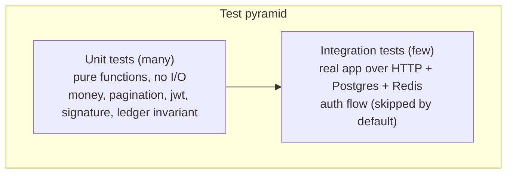

# Testing

StripeForge is tested with **[Vitest](https://vitest.dev)** (unit + integration) and
**[supertest](https://github.com/ladjs/supertest)** (HTTP-level integration against the
real Express app). Config: `backend/vitest.config.ts` (node environment,
`include: ['tests/**/*.test.ts']`).

## Strategy

Testing follows the classic pyramid — many fast unit tests, fewer integration tests:



- **Unit tests** cover **pure, deterministic** logic with no DB/Redis/network. They run
  everywhere — including a clean CI checkout with no services — and are the bulk of the
  suite.
- **Integration tests** exercise routing → middleware → auth → service → repository → DB
  over real HTTP. They prove the **seams**. They require Postgres + Redis and are
  **`describe.skip`-ped by default** so a plain `npm test` needs zero infrastructure.

Every test file opens with a `WHY THIS TEST EXISTS` comment — tests document intent.

## Tools

| Tool | Role |
| --- | --- |
| **Vitest** | Test runner + assertions (`describe`/`it`/`expect`), fast, TS-native |
| **supertest** | Drives the exported Express `app` over HTTP without binding a port |
| **Postgres + Redis** | Backing services for integration tests (Docker / CI service containers) |

## What's covered and why

Located under `backend/tests/`:

### Unit (`tests/unit/`)

| File | Covers | Why it exists |
| --- | --- | --- |
| `money.test.ts` | `serialize()` BigInt→number, recursive, arrays/nesting, zero, large-safe ints, pass-through | Money is `BigInt` and `JSON.stringify` throws on it; `serialize` is the single boundary that keeps **every** money endpoint JSON-safe |
| `pagination.test.ts` | `parsePagination` bounds (min 1, max 100), coercion, `skip` math, the falsy-`0` quirk | Guards against unbounded page requests exhausting memory; off-by-one prone |
| `jwt.test.ts` | `signAccessToken`/`verifyAccessToken` round-trip + tamper rejection + opaque refresh token | `requireAuth` trusts `verifyAccessToken`; proves the signature is actually enforced |
| `webhookSignature.test.ts` | `signPayload`/`buildSignatureHeader`/`verifySignature`: valid, tampered, wrong secret, malformed, replay window | Signatures are how merchants trust deliveries; each property must hold |
| `ledger.invariant.test.ts` | double-entry invariant (debits == credits), account/direction mapping, derived balance, dropped-leg guard | The accounting core; a broken invariant silently loses/invents money |

### Integration (`tests/integration/`)

| File | Covers | Why it exists |
| --- | --- | --- |
| `auth.flow.test.ts` (skipped) | register → login → protected route (401 vs 200) → refresh, over real HTTP | Proves the whole stack + response envelope fit together; reference template |
| `README.md` | How to stand up a test DB and enable integration tests | Onboarding |

### Notes on robustness

- `jwt.test.ts` sets the minimal required env **before** importing the module (which
  transitively imports `config/env`, validated at load) and **guards** with a dynamic
  import so it self-skips rather than failing if env/module can't load.
- `ledger.invariant.test.ts` **replicates** the service's exact leg-construction shape
  (documented against `src/services/ledger.service.ts`) so the invariant is proven without
  needing a live DB — the service builds legs inside a Prisma transaction.

## How to run

```bash
cd backend

npm test                            # all (unit; integration skipped)
npm run test:watch                  # watch mode
npx vitest run tests/unit           # unit only
npx vitest run tests/integration    # integration (needs Postgres+Redis; skipped by default)
```

Enabling integration tests: see `backend/tests/integration/README.md` (stand up Postgres
+ Redis, apply migrations, flip `describe.skip` → `describe`).

## In CI

`.github/workflows/ci.yml` runs, on the backend: `prisma generate` → `typecheck` →
`lint` → `vitest run tests/unit`; and on the frontend: `lint` → `build`. It also
provisions **postgres** and **redis** service containers so integration tests *can* be
enabled in a follow-up step; by default they stay skipped to keep CI fast and green.

## Adding tests

- Unit-test any new pure helper (money math, validators, state-transition guards).
- Add an integration case when you introduce a new HTTP seam or a cross-layer invariant.
- Start each file with `WHY THIS TEST EXISTS`.
- Prefer deterministic inputs; avoid real time/network in unit tests (the signature test
  uses controlled timestamps for exactly this reason).
