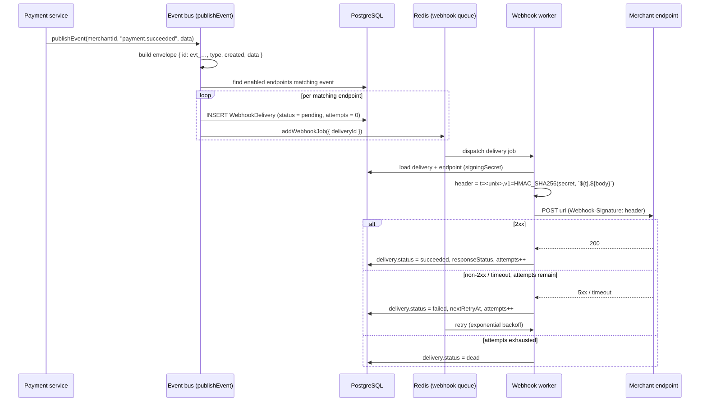

# Webhooks

Webhooks let StripeForge push events (a payment succeeded, a refund was created) to a
merchant's server in real time, instead of the merchant polling. Deliveries are
**signed** (so the merchant can verify authenticity), **retried** with backoff, logged,
and dead-lettered when they can't be delivered. This mirrors how Stripe webhooks work.

## Concepts

| Object | Table | Role |
| --- | --- | --- |
| **Endpoint** | `WebhookEndpoint` | A merchant-registered URL + signing secret + subscribed events |
| **Event** | (envelope) | A domain thing that happened (`payment.succeeded`, …) |
| **Delivery** | `WebhookDelivery` | One attempt-tracked send of an event to an endpoint |

## Event types

Published by the event bus (`SUPPORTED_EVENT_TYPES` in `src/events/eventBus.ts`):

| Event | Fired when |
| --- | --- |
| `payment.processing` | A PaymentIntent is confirmed and a Payment enters `processing` |
| `payment.succeeded` | A Payment is captured successfully |
| `payment.failed` | A capture fails |
| `refund.created` | A Refund is created for a payment |

An endpoint subscribes via `enabledEvents` (a `String[]`). An **empty** list means "all
events". See [`payment-lifecycle.md`](./payment-lifecycle.md) for exactly when each fires.

## Endpoint registration

Merchants manage endpoints via the API (see [`api.md`](./api.md)):

- `POST /api/v1/webhook_endpoints` — register `{ url, enabledEvents?, enabled? }`. The
  server generates a `signingSecret` and returns it **once**.
- `GET /api/v1/webhook_endpoints` — list endpoints.
- `PATCH /api/v1/webhook_endpoints/:id` — update URL / events / enabled.
- `DELETE /api/v1/webhook_endpoints/:id` — remove.

## Delivery flow



The delivery is persisted **`pending` before** the job runs, so a worker crash never loses
an event.

## HMAC signature scheme

StripeForge uses a Stripe-style signature (see `src/webhooks/signature.ts`). Each delivery
carries a header:

```
Webhook-Signature: t=1752624000,v1=<hex sha256 hmac>
```

- `t` — the Unix timestamp (seconds) when the signature was produced.
- `v1` — `HMAC_SHA256(signingSecret, "${t}.${rawBody}")` as lowercase hex.

Including the timestamp **in the signed content** (not just alongside it) means an
attacker can't reuse an old signature with a new timestamp, and the receiver can reject
signatures whose timestamp is outside a tolerance window (replay defense).

### How a merchant verifies it

1. Read the `Webhook-Signature` header and split out `t` and `v1`.
2. Recompute `HMAC_SHA256(signingSecret, "${t}.${rawRequestBody}")`.
   **Use the raw bytes** of the body — re-serialising JSON can change whitespace/key order
   and break the signature.
3. Compare in **constant time** (StripeForge uses `crypto.timingSafeEqual`) to avoid
   leaking the secret via timing.
4. Reject if `|now − t|` exceeds your tolerance (default 300s).

```ts
// Merchant side — Node example using the same algorithm.
import { createHmac, timingSafeEqual } from 'node:crypto';

function verify(rawBody: string, header: string, secret: string, toleranceSec = 300) {
  const parts = Object.fromEntries(header.split(',').map((p) => p.split('=')));
  const t = Number(parts.t);
  if (!parts.v1 || Number.isNaN(t)) return false;
  if (Math.abs(Math.floor(Date.now() / 1000) - t) > toleranceSec) return false;

  const expected = createHmac('sha256', secret).update(`${t}.${rawBody}`).digest('hex');
  const a = Buffer.from(expected, 'hex');
  const b = Buffer.from(parts.v1, 'hex');
  return a.length === b.length && timingSafeEqual(a, b);
}
```

StripeForge ships `signPayload`, `buildSignatureHeader`, and `verifySignature`, and the
scheme is unit-tested in `backend/tests/unit/webhookSignature.test.ts` (valid/tampered/
wrong-secret/malformed/replay cases).

## Event envelope

The delivery body (and stored `payload`) is a stable envelope:

```json
{
  "id": "evt_9f2c…",
  "type": "payment.succeeded",
  "created": 1752624000,
  "data": {
    "id": "pay_…",
    "amount": 2500,
    "currency": "usd",
    "status": "succeeded"
  }
}
```

Merchants **deduplicate on `id`** — since retries re-send the same event id, processing is
naturally idempotent.

## Retries & dead-letter

Retries are handled by the BullMQ webhook queue with exponential backoff, capped at
`WEBHOOK_MAX_ATTEMPTS` (default 5). Each attempt updates the `WebhookDelivery`
(`attempts`, `responseStatus`, `responseBody`, `nextRetryAt`). When attempts are
exhausted, `status` becomes **`dead`** — the delivery is not dropped, it stays visible for
inspection/manual re-drive. Full retry mechanics: [`queues.md`](./queues.md).

## Delivery logs

Every delivery is queryable:

- `GET /api/v1/webhook_deliveries` — list deliveries with `status`, `attempts`,
  `responseStatus`, `eventType`, timestamps.

This is the merchant's (and dashboard's) window into what was sent, what succeeded, and
what is stuck — see [`api.md`](./api.md) and [`database.md`](./database.md#webhookdelivery-webhook_deliveries).

## Security notes

- The `signingSecret` is per-endpoint and shown once at creation.
- StripeForge only POSTs to merchant-provided URLs; in production you'd also want SSRF
  protections (block internal IP ranges) — noted in [`security.md`](./security.md) and
  [`future-roadmap.md`](./future-roadmap.md).
